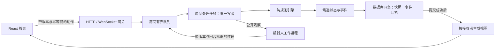

# 《暗潮航线》技术设计与原型规划

> 历史设计 v0.1，已被[独立 3D 客户端与在线牌局后端设计 v0.2](../../technical-design.md)取代。网页与 Python 产品后端的选择不再是当前方向。

版本：设计稿 v0.1 · 2026-10-09  
依据：[标准牌局规则 v1.0](../../standard-rules.md)  
交付范围：设计文档与低保真交互原型说明。本轮不实现服务端、网页、数据库迁移或新规则引擎。

## 1. 本次设计的产品假设

按网页五人房间设计，允许在开局前用机器人补足空位，也可用同一架构形成一名真人对四名机器人的练习房。平台偏好尚未最终确认，这一假设不改变标准规则；先实现哪一种入口可在进入开发前决定。

一场仍为五人各 100 枚、最多 12 局、前六局底注 1／后六局底注 2，反向改航及实际顺位 5%→10% 收费。不增加充值、交易、买入或真实货币。第一版关注完整对局、规则可解释、断线重连和可复现的错误记录。

**核心技术决策：服务器拥有唯一真实牌局；每个房间的动作按顺序提交；不同房间通过异步任务并发；机器人计算通过独立进程并行。** 玩家只收到有权看到的信息，不能靠修改网页绕过规则。

设计分为四份详细规格：

| 文档 | 解决的问题 |
| --- | --- |
| [领域数据与规则引擎](technical/domain-and-engine.md) | 每个值放在哪、类型与范围、常量和枚举、状态机、下注与分池算法、循环何时停止 |
| [接口、持久化与并发](technical/protocol-and-concurrency.md) | 动作如何提交、如何去重、谁能改状态、超时和断线、数据库事务、机器人晚到结果 |
| [界面原型与验收](technical/prototype-and-validation.md) | 页面和牌桌布局、交互状态、公开改航信息、错误反馈、测试场景及开发顺序 |
| [空间、内存与容量预算](technical/capacity-and-storage.md) | 数据数量上限、缓存/队列容量、网络和磁盘估算、性能目标、扩容条件 |

本文与四份详细规格共同构成设计包。文中的技术参数是初始工程建议，规则文档决定游戏行为；未测试的容量不会写成已实现能力。

## 2. 技术栈选择

| 层 | 选择 | 理由与边界 |
| --- | --- | --- |
| 网页 | React＋TypeScript，开启严格类型检查；Vite 构建 | 回合制牌桌以按钮、卡牌、列表和状态提示为主；组件化与协议类型比游戏物理引擎更有价值 |
| 页面绘制 | HTML／CSS Grid／SVG 卡牌，CSS 动画 | 花色同时有形状与颜色；不需要每帧重绘整个桌面，不引入 Canvas／WebGL 渲染循环 |
| 网页状态 | 服务器视图用独立 reducer；Zustand 仅保存选择、面板和动画等本地状态 | 服务器筹码、牌和阶段只保留一份；客户端不会另算一套结算结果 |
| HTTP 与 WebSocket | Python 3.13、FastAPI、Pydantic 2 | 现有规则与概率研究使用 Python，便于逐步抽取已有算法；Pydantic 只放在输入输出边界 |
| 领域模型 | 标准库枚举、带 slots 的数据类、整数与短数组 | 类型明确、对象开销可控；不让 ORM、WebSocket 或请求对象进入牌局状态 |
| 并发运行时 | asyncio；每房间一个有界队列和一个处理任务 | 单房间天然串行，避免加注、超时、改航同时修改同一状态 |
| 机器人 | 受限进程池，首版建议两个工作进程 | 概率计算不阻塞网络事件循环；线程不能作为 Python CPU 计算的默认并行方案 |
| 持久化 | PostgreSQL 17；psycopg 3 异步连接池 | 保存最新快照、事件和指令回执，事务内统一提交；原型也需要验证重试与恢复 |
| 模式升级 | 明确版本号的 SQL 迁移；开发阶段可采用 Alembic | 数据变更有记录；不使用启动时自动创建或随意修改线上表结构 |
| 接口类型 | HTTP 用 OpenAPI；WebSocket 消息用版本化 JSON Schema | 实现阶段生成 TypeScript 类型，避免前后端手工各维护一份协议 |
| 测试 | pytest、Hypothesis、Vitest、Playwright；现有 unittest 继续保留 | 分别负责规则例子、性质验证、前端状态与端到端对局；历史统计测试仍可独立复现 |
| 本地部署 | 一个 API 进程、一个 PostgreSQL 服务、开发期 Vite；可用 Compose 管理 | 不将多个 Uvicorn worker 直接当作房间扩容机制；每个房间只能有一个拥有者 |
| 对外部署 | 静态资源与 TLS／WebSocket 反向代理，API 容器，独立数据库 | 具体主机和域名在部署阶段决定；本轮不部署 |

现有模拟已在 Python 3.14 上运行。计划中的服务端基线选 3.13，是新工程依赖兼容性的初始选择；实施时验证并锁定版本及依赖，不假定已有环境已经安装上述框架。前端依赖同样在实施时选择相互兼容的稳定版本并提交锁文件。

首版不需要 Redis、消息中间件、微服务、跨服务分布式事务或客户端运行另一份完整规则引擎。它们只有在出现具体容量或部署需求时才引入。

## 3. 模块边界与一次动作的路径

推荐代码边界只是未来目录规划，本轮不创建这些实现目录：

| 计划模块 | 职责 | 禁止混入的内容 |
| --- | --- | --- |
| domain/cards、rules、state | 编码、不可变规则集、领域状态与不变量 | 连接、用户会话、数据库游标 |
| domain/betting、pots、swap、settlement | 合法动作与状态转移，主边池和费用池结算 | HTTP 异常、前端动画、真实时钟读取 |
| application/room_actor | 指令队列、截止时间、调用规则与持久化、安排下一动作 | 牌型的另一套实现 |
| application/projection | 生成某位玩家可见的快照与公开事件 | 通用地序列化服务器私有状态 |
| transport/http、ws、schemas | 鉴权、消息校验、回执与连接管理 | 直接扣筹码、移动牌库游标 |
| persistence | 事务、乐观版本条件、快照迁移与读取 | 决定输赢 |
| bots | 用本人观察及公开历史提出合法动作建议 | 牌库未来顺序、其他人的底牌 |
| web/transport、state、components | 接收投影、展示和输入 | 决定最终费用、发牌结果和获奖资格 |
| simulation | 批量策略实验、配对统计、参考实现 | 网页服务的同步请求循环 |

每条玩家指令只推进至“需要下一次外部动作”或结算展示边界。不能让一个 WebSocket 请求调用现有 run_match 后一直等到整场结束。

## 4. 三类版本与三类状态必须分开

| 概念 | 含义 |
| --- | --- |
| ruleset_id / ruleset_version | 本场采用的规则，标准值为 dark-tide-standard-1.0 / 1.0；开局后固定 |
| state_schema_version / protocol_version | 保存数据和通信格式的版本，用于兼容与迁移 |
| state_revision | 外层 RoomSnapshot 的唯一权威版本；房间生命周期内递增，跨整场不重置；准备、开局、动作及控制权变更递增，临时在线状态不递增 |
| turn_id | 当前一次行动机会初建时生成并持久化的 UUID；新机会换值，重连或控制权交接保留原值和期限 |
| 领域状态 | 筹码、发牌、阶段、资格与已完成动作，必须可持久化与恢复 |
| 运行状态 | Socket、队列、定时任务、机器人任务句柄，服务进程内重建 |
| 展示状态 | 滑杆当前输入、选中的改航位置、动画进度、展开的日志面板 |

玩家的座位编号在整场固定为 0—4。起始位、下注顺位、改航顺位和本人屏幕中的位置是另外四个概念，不能用一个 index 同时表示。玩家淘汰后不压缩座位数组。

全下是“仍参与本局且可用余额为零”的派生状态；超额退款可能解除它。淘汰只在本局完全结算后判定；断线只是连接状态。三个状态不得合成一个 inactive 布尔值。

## 5. 规则引擎与状态推进原则

规则引擎以权威状态和已验证命令为输入，返回候选状态、领域事件及下一步等待条件。它不调用数据库、不等待网络、不读取用户身份令牌，也不在内部偷偷取得当前时间。

一次指令的建议处理顺序为：身份与房间访问校验 → 同 command_id 回执查重 → 当前控制权、版本、turn_id、入队时间和合法动作校验 → 在独立候选状态上推进 → 不变量检查 → 单事务写入 → 替换内存权威状态 → 回执与投影广播。成功动作重试时应先返回原回执，不能因行动已推进或标签页已交接控制权而误报失败。完整的去重、超时和故障顺序见协议规格。

随机洗牌由服务器安全随机源完成，结果作为本局私有数据持久化。引擎推进消费已经确定的牌库顺序；恢复后不重新洗牌。离线模拟仍允许显式随机种子以复现实验，不能将离线可预测种子直接作为联机牌局的公开信息。

标准规则应有独立、不可随房主输入任意修改的规则集定义，明确 reverse_swaps=true、low_bps=500、high_bps=1000。现有 Config() 默认正序用于历史实验，不能直接当成新产品默认配置。

金额全部使用整数；客户端不得传“我的胜率”“我的改航费”“我能赢哪个池”作为服务器结算依据。下注指令金额定义为本次新增投入，包含跟注部分，界面另外展示本轮累计目标。

## 6. 信息边界与行为历史

对外视图按允许公开的字段逐项构造。当前底牌只有本人能收到；其他玩家只显示持牌数量，正式摊牌后才公开有资格玩家的底牌。旁观者、淘汰者、其他标签页的可见权限必须显式定义，不能复用调试用全量 trace。

公开行为历史从第一版记录，至少包括行动者、阶段、下注动作和金额、改航顺位、改航或放弃、目标位置、换出牌、随机换入牌、支付费用、退款、结算分配。应区分“主动放弃改航”“余额不足而跳过”“全下而不在名单”，这些行为的含义不同。

这样真人能够读懂改航信号，未来机器人也有可用的公开历史。首版机器人仍可采用现有局部概率策略；保存历史不代表已经实现对手手牌范围推断。

## 7. 原型应该验证什么

原型需要让一名真人能够完成一整场，能够观察五人桌、下注、反向改航、全下、多个池与结算，并能在刷新后恢复正确私有视图。多人房间模式增加准备、入座、重连和控制权处理，二者共用规则引擎。

原型重点验证五个容易出错的交互：

1. 玩家分得清“本次再投入多少”与“本轮加到多少”。
2. 在二注结束后能看到反向操作名单与冻结价格，前人换牌不会使后人报价跳变。
3. 全下者知道自己仍在本局，并能看懂自己可争夺的池。
4. 断线恢复不会重复下注，迟到的机器人、定时器或旧标签页不能替当前玩家操作。
5. 每个接收者只看到自己有权看到的底牌，调试日志不能改变这一点。

线框、按钮状态和验收场景见原型规格。界面可以显示与玩家决策有关的规则解释，不显示 state_revision、数据库事务或内部事件编号。

## 8. 资源与并发起点

先以单服务进程管理 **100 个活跃房间、500 个玩家连接**作为工程验证目标，不声称已达到。每房间一个动作串行处理任务；进程池建议两个机器人计算工作进程；数据库连接池建议 2—10 个连接。

每房间指令队列 64 项、单条客户端消息最大 16 KiB、每连接出站队列最多 16 条且不超过 64 KiB。队列满时明确拒绝或断线恢复，不能无限积压，也不能静默丢弃一条已经接受的游戏动作。

等待真人动作使用队列和截止时间，服务器不做每秒广播一次的全房间倒计时，不设 60 FPS 游戏循环。浏览器用服务器截止时间绘制本地倒计时，动画循环只负责呈现。

以上数量、内存估算、磁盘增长及压测场景见容量规格。任何扩容都先检查瓶颈是机器人 CPU、数据库写入、Socket 缓冲还是队列等待，不把增加 worker 数当作通用解决方案。

## 9. 从已有研究代码走向原型

| 已有资产 | 复用方式 | 需要补的工作 |
| --- | --- | --- |
| 标准规则与 27 张牌编码 | 作为唯一规则输入 | 生成独立标准规则集，防止实验默认值混入 |
| three_suit_analysis / fast_score | 复用牌型与九组合比较逻辑 | 将快速表和缓存边界独立成模块，继续和精确参考实现比对 |
| persistent_game | 作为逐动作行为的参考实现 | 拆解本地同步循环为可暂停、可恢复的状态机；显式保存轮次、待响应名单和短全下历史 |
| 主池／边池／费用池算法 | 复用已验证的规则与例子 | 从无类型 dict 拆成明确模型，加入序列化与事务边界 |
| persistent_policy | 首版机器人基础 | 接收按玩家生成的观察；离开事件循环；结果带版本与回合标识 |
| 现有 103 项测试 | 保留为迁移回归依据 | 新增真人暂停、幂等重试、崩溃恢复、WebSocket 信息隔离等测试 |
| 配对模拟报告 | 用于解释当前规则选择 | 不把启发式统计结论当作联网系统正确性证明 |

实施顺序建议为：领域契约与可暂停规则引擎 → 终端级指令回放和性质测试 → 单房间持久化服务 → 网页一人对四机器人闭环 → 多人连接与故障测试 → 容量压测。每一步的完成条件见原型与验证规格。

当前只完成设计。上述新模块、框架依赖、服务、数据库表和页面均尚未创建或上线。
