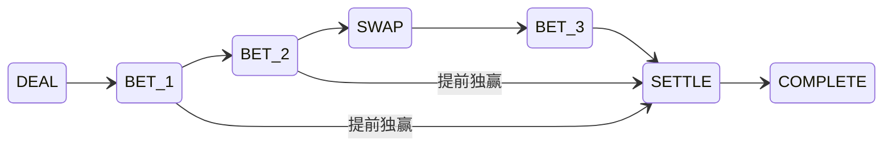

# 领域数据与规则引擎设计

> 历史设计，当前入口见[技术设计 v0.2](../../../technical-design.md)。

日期：2026-10-09。状态：设计稿，不是已实现接口。本文只规定数据、状态迁移和实现边界，不新增玩法，也不修改现有模拟脚本。

规则依据为 [《暗潮航线》标准牌局规则 v1.0](../../../standard-rules.md)。目标是同一规则核心既能驱动真人房间，也能运行机器人模拟和确定性回放。房间以五个固定席位开始，玩家淘汰后不压缩席位编号。

## 1. 核心约束与模块边界

建议规则核心使用 Python 3.13、带 `slots` 的不可变数据类、枚举和整数运算。固定长度的五人数组使用元组；修改动作生成一个候选状态，避免调用方持有的旧状态被改写。

规则核心接收经过身份解析的命令和当前状态，输出候选状态、领域事件及下一项等待条件。它不拥有 WebSocket、HTTP 会话、用户名、认证令牌、数据库连接、系统时钟或机器人线程。

| 层 | 负责 | 不放入规则状态的内容 |
| --- | --- | --- |
| 房间与席位 | 加入、准备、五个席位与参与者身份的绑定、开始新整场 | 底牌计算和下注判定 |
| 整场与牌局 | 12 局、筹码、牌库、下注、改航、分池、结算 | 在线状态、网络重连状态 |
| 房间执行器 | 串行接收命令，安排计时和机器人工作，持久化后发布结果 | 自行修改金额、手牌或获奖资格 |
| 连接与展示 | 将私有状态投影为某个观看者能看到的数据，发送更新 | 以客户端状态作为游戏事实来源 |
| 策略工作进程 | 读取与该机器人同等权限的观察，返回动作建议 | 获得真实牌库、其他底牌或直接写入房间状态 |

一次动作的流程为：

`当前状态 → 验证命令 → 生成候选状态与事件 → 校验不变量 → 持久化成功 → 替换内存状态 → 向各观看者发布投影`

持久化失败时保留旧状态，不先发布一个尚未成功记录的结果。客户端确认、动画结束、连接恢复都不应直接推进牌局。

## 2. 基础类型与标准常量

下表中的紧凑宽度是二进制编码所需位数，不是 Python 对象的实际内存占用。

| 名称 | 领域类型与范围 | 紧凑编码参考 | 约束 |
| --- | --- | --- | --- |
| `Seat` | 整数 0…4 | 3 位；实际可用 1 字节 | 表示整场固定席位，不是当前行动顺位 |
| `SeatMask` | 整数 0…31 | 5 位；实际可用 1 字节 | 第 p 位代表席位 p，禁止高位 |
| `CardId` | 整数 0…26 | 5 位；实际可用 1 字节 | `suit = id // 9`，`rank = id % 9 + 1` |
| `CardMask` | 整数 0…2²⁷−1 | 27 位；实际可用 4 字节 | 用于去重、计算未知牌集合；不是另一份牌库 |
| `Suit` | `RED=0, BLUE=1, GREEN=2` | 2 位 | 仅显示和判断同花，不参与胜负排序 |
| `Chips` | 整数 0…500 | 无符号 16 位足够 | 所有实存余额、投入、奖池金额都在此范围 |
| `FiveChips` | 长度恰为 5 的 `Chips` 元组 | 10 字节 | 所有数组始终按绝对席位索引 |
| `HandIndex` | 整数 1…12 | 1 字节 | 尚未开第一局时用独立状态表示，不假造第 0 局 |
| `BasisPoints` | 标准中固定为 500 或 1000 | 无符号 16 位 | 500 = 5%；计算中间比例用整数分子与分母 |
| `state_revision` | 房间生命周期内单调整数，初值 0 | 64 位 | `RoomSnapshot` 唯一权威版本，跨整场不重置；准备、开局、动作、控制权变化递增，presence 不递增 |
| `turn_id` | UUID | 字符串或固定二进制标识 | 输入机会首次建立时生成并持久化；重连、控制权转移不重建 |
| `command_id` | 客户端或系统生成的唯一标识 | UUID 等 | 用于重试去重；不能替代权限和版本校验 |

Python 中 `bool` 是 `int` 的子类，边界校验应拒绝将 `True` 当作席位、牌号或下注额。外部字符串、浮点数、负数和超范围金额不得依赖隐式类型转换接受。

范围 0…500 约束的是实存金额，不约束尚未截断的计算中间值。例如 `P+2C` 可大于 500，报价的整数分子也远大于 65535。Python 中保持整数计算；如以后做紧凑二进制实现，中间乘法至少用 32 位，再校验最终值后写入 16 位金额字段。

产品定义独立的不可变 `STANDARD_V1`，至少锁定：

| 常量 | 值 |
| --- | --- |
| `RULESET_ID` | `dark-tide-standard-1.0` |
| `RULESET_VERSION` | `1.0` |
| 初始玩家数／固定席位数 | 5／5 |
| 每人初始筹码／整场总量 | 100／500 |
| 最大局数 | 12 |
| 第 1…6 局底注 | 1 |
| 第 7…12 局底注 | 2 |
| 最小正常开注 | 当前底注 × 2 |
| 改航方向 | 原下注顺序的反向 |
| 改航首末比例 | 500／1000 bps |
| 单人改航比例 | 1000 bps |
| 每人每局改航上限 | 1 |
| 可改公共位置 | 0、1 |
| 牌库大小／底牌数／最终公共牌数 | 27／2／3 |
| 最终选牌数／最少底牌数 | 3／1 |

历史 `simulation/persistent_model.py` 的 `Config.reverse_swaps` 默认仍为 `False`，历史实验也有其他费率。产品入口不得直接继承这个默认值；标准房间引用 `STANDARD_V1`，实验配置另有明确命名。

## 3. 状态与枚举分开定义

### 3.1 不同生命周期的状态

| 对象 | 候选枚举 | 语义及存储位置 |
| --- | --- | --- |
| 房间 `RoomStatus` | `WAITING, STARTING, PLAYING, RESULTS, CLOSED` | 控制加入、准备与整场切换；属于房间层，不是牌局阶段 |
| 整场 `MatchStatus` | `RUNNING, FINISHED` | 开始后持续到第 12 局结算或只剩一人；维护故障暂停由执行器管理，不产生另一种游戏胜负 |
| 牌局 `HandPhase` | `DEAL, BET_1, BET_2, SWAP, BET_3, SETTLE, COMPLETE` | `DEAL/SETTLE` 是自动迁移阶段；其他阶段可能等待玩家输入 |
| 连接 `PresenceStatus` | `ONLINE, OFFLINE` | 房间成员的当前连接事实；不修改筹码或房间 `state_revision` |
| 控制者 `ControllerKind` | `HUMAN, BOT` | 谁负责提供命令；断线与是否弃牌无关，自动代行动作也不能直接改控制者或游戏资格 |
| 玩家视图 `HandPlayerStatus` | `NOT_IN_HAND, FOLDED, ALL_IN, TO_ACT, WAITING` | 根据下述权威字段计算，仅用于投影 |
| 整场玩家视图 | `ACTIVE, ELIMINATED` | 只在局间依据结算后的余额判断，不由局中余额零推断淘汰 |

`ALL_IN` 不单独持久化成一个不可撤销状态。它由“参加本局、未弃牌、当前未投入余额为 0”计算。超额下注退款后余额恢复，玩家可能重新参与后续合法阶段；旧的 `all_in=True` 标记不能把他永久锁住。

`pending_mask`、`folded_mask` 和连接状态不可混用。断线玩家依然占原席位，能否行动仍按规则决定；超时处理须提交一个可通过规则校验的动作。

### 3.2 命令与事件

玩家命令类型固定为：`CHECK, CALL, RAISE, FOLD, SWAP, PASS_SWAP`。

| 命令 | 业务负载 | 关键解释 |
| --- | --- | --- |
| `CHECK` | 无 | 待跟注额必须为 0 |
| `CALL` | 无金额 | 引擎计算 `min(余额, 待跟注额)`，包含不足额全下 |
| `RAISE` | `add_chips: Chips` | 本次新增投入，包含跟注；与线上协议 `bet.raise.payload.add_chips` 同名同义，不是本轮累计目标额 |
| `FOLD` | 无 | 必须有待跟注额；全下者不能执行 |
| `SWAP` | `slot: 0或1` | 费用取冻结报价，客户端不能自行提交费用 |
| `PASS_SWAP` | 无 | 消耗这一次机会，不付款 |

“全下”是一个结果，不需要再维护独立 `ALL_IN` 命令语义。界面上的全下按钮映射为合法的 `CALL` 或 `RAISE`；若余额超过底池允许新增投入，不能用该按钮突破上限。

可信系统命令可以包括 `START_MATCH, DEAL_HAND, START_NEXT_HAND`。`DEAL_HAND` 携带服务端产生的洗牌结果；普通玩家不能调用它或指定牌序。超时、机器人也提交同一套玩家动作，只在命令来源元数据中注明原因。

命令封套使用统一字段：`command_id, expected_revision, turn_id, actor_seat, kind, payload`。`actor_seat` 由房间层从身份与固定席位绑定得出，不信任客户端自报。纯引擎只处理已经解析的席位。

领域事件可包括：`HandStarted, AntePaid, CardDealtPrivate, BoardRevealed, ActionApplied, UncalledRefunded, SwapWindowQuoted, SwapPassed, BoardReplaced, PotAwarded, HandSettled, PlayerEliminated, MatchFinished`。可见字段由投影层明确挑选，不能将完整状态或内部事件直接广播。

## 4. 权威数据结构

下列是建议字段设计，不要求逐字照搬现有 Python 类。生产数据类采用 `frozen=True, slots=True`，嵌套容器也保持不可变。`slots` 降低实例字典开销，但不让 Python 整数自动变成 16 位。

“快照”指可恢复整场的服务端私有快照；“事件”指可回放的服务端记录。写入数据库并不等于对客户端可见。

### 4.1 整场 `MatchState`

`MatchState` 嵌入 `RoomSnapshot`。后者保存唯一权威的 `state_revision`，房间从准备、开局到不同整场之间持续递增；`MatchState` 不另存一个可重置的版本。需要显示或验证版本时，直接引用外层快照值。

| 字段 | 类型／范围 | 生命周期 | 可见性 | 持久化／权威性 |
| --- | --- | --- | --- | --- |
| `match_id` | 稳定标识 | 整场 | 公共标识 | 快照与事件；权威 |
| `ruleset_id, ruleset_version` | 固定标准标识 | 整场不可变 | 公共 | 快照；权威，回放按原版本解释 |
| `status` | `RUNNING/FINISHED` | 整场 | 公共 | 快照；权威 |
| `stacks` | `FiveChips` | 整场，局中表示尚未投入的余额 | 公共 | 唯一可变余额账本；权威 |
| `button` | `Seat` | 当前局；局后顺时针跳过零余额者移动 | 公共 | 快照；权威 |
| `hand_index` | `1…12` 或尚未开始 | 整场 | 公共 | 快照；权威 |
| `hand` | `HandState` 或空 | 当前局 | 按字段投影 | 私有快照；权威 |
| `last_result` | 最新一个 `HandResult` 或空 | 最近已结算局；不保存全部历史列表 | 按摊牌范围投影 | 快照中的不可变结果，便于结算页重连 |
| `final_winners_mask` | `SeatMask` 或空 | 整场结束后 | 公共 | 可由最终余额推导；结果事件保存，不再另维护可变赢家表 |

参与者账号、昵称、头像、连接 ID 与控制方式存在房间成员表，不进入此结构。规则只需要稳定的五个席位。

### 4.2 当前局 `HandState`

| 字段 | 类型／范围 | 生命周期 | 可见性 | 持久化／权威性 |
| --- | --- | --- | --- | --- |
| `phase` | `HandPhase` | 当前局 | 公共 | 快照；权威 |
| `start_stacks` | `FiveChips` | 开局冻结，局后转入结果 | 公共 | 快照；不可变事实，只用于净收益，不作为可花余额 |
| `in_hand_mask` | `SeatMask` | 底注前按有筹码席位冻结 | 公共 | 快照；权威 |
| `folded_mask` | `SeatMask`，必须为 `in_hand_mask` 子集 | 当前局，只增不减 | 公共 | 快照；权威 |
| `start_order` | 长度 2…5 的唯一席位元组 | 当前局冻结 | 公共 | 快照；权威；三轮下注及余筹使用它 |
| `deck_order` | 27 个 `CardId` 的排列，建议 `bytes` | 开局冻结 | 仅服务端 | 私有快照／私有洗牌事件；权威 |
| `deck_cursor` | `0…18`，并额外验证不超过 27 | 当前局，只增不减 | 只公开已发数量，不公开未发牌 | 私有快照；权威 |
| `holes` | 五个“空或两张牌”元组 | 发牌后冻结 | 仅本人；必要摊牌时公开未弃牌者 | 私有快照／私有事件；权威 |
| `board` | 长度 0…3 的牌元组 | 当前局，可替换前两位置 | 公共 | 快照与事件；权威 |
| `discarded` | 长度 0…5 的牌元组 | 改航时追加 | 公共 | 快照与事件；权威 |
| `regular_contributions` | `FiveChips` | 本局底注与三轮普通下注，退款时减少 | 公共 | 普通投入唯一金额账本；权威 |
| `bonus_buckets` | 最多 5 个 `BonusBucket(amount, frozen_eligible_mask)` | 改航付款后建立 | 公共 | 附加费用唯一金额账本；权威 |
| `betting` | `BettingRoundState` 或空 | 某轮下注 | 公共可见事实；内部细节可不传 | 快照；权威 |
| `swap_window` | `SwapWindowState` 或空 | 改航窗口 | 报价和资格公开 | 快照；权威 |

最多发出 5×2 张底牌、3 张公共牌、5 张改航替换牌，共 18 张，因此 27 张牌足够。弃牌者的底牌仍算已发牌，不重新入库。

不另存可变的 `pot_total, live_players, all_in_players, eliminated_players, can_raise`。总池由账本求和，其他状态由掩码、余额与阶段推导。为展示缓存这些值时，必须注明它们是带 `state_revision` 的投影，不参与下一动作的规则判断。

### 4.3 下注轮 `BettingRoundState`

| 字段 | 类型／范围 | 生命周期 | 可见性／持久化 | 用途 |
| --- | --- | --- | --- | --- |
| `street_paid` | `FiveChips` | 每轮从零开始 | 公共事实；快照 | 计算本人待跟注额 |
| `target` | `Chips` | 每轮从零开始，轮内单调增加 | 公共；快照 | 本轮当前目标额 |
| `last_full_raise` | 正整数，初值 `2×ante` | 每轮重新初始化 | 规则事实；快照 | 最低完整加价幅度 |
| `pending_mask` | 活跃且有余额玩家的子集 | 当前轮，动作消费／加注后重建 | 内部快照；投影可显示待响应者 | 谁还须响应本轮 |
| `committed_mask` | `SeatMask` | 当前轮 | 内部快照 | 谁已经下注或跟注，区别于只过牌者 |
| `last_target` | `FiveChips` | 当前轮 | 内部快照 | 每人上次下注／跟注时面对或建立的目标 |
| `cursor` | `Seat` | 当前轮 | 内部快照 | 从哪个物理位置开始找下一个待行动者 |

`responded_mask` 如用于界面，应由当前轮有余额的活跃玩家减去 `pending_mask` 推导，不再维护第二份响应账本。单靠 `street_paid == target` 不能判断已响应：目标为零时，尚未行动者和已经过牌者的投入都为零。

`last_target` 只有在 `committed_mask` 对应位为真时约束重新加注；一次免费过牌不锁住加价权。`cursor` 不等于起始标记，轮内会移动，不能反过来修改下一轮的 `start_order`。

### 4.4 改航窗口 `SwapWindowState`

| 字段 | 类型／范围 | 生命周期 | 可见性／持久化 | 用途 |
| --- | --- | --- | --- | --- |
| `order` | 长度 0…5 的唯一席位元组 | 窗口开始冻结 | 公共；快照与报价事件 | 从可操作者名单反向排列得到 |
| `quotes` | 与 `order` 同长的 `SwapQuote` 元组 | 窗口开始冻结 | 公共；快照与报价事件 | 含席位、顺位、E、整数费用、冻结附加池资格 |
| `next_index` | `0…len(order)` | 消费机会时递增 | 公共可显示；快照 | 每人只获得一次机会 |

`SwapQuote` 的 `fee` 是应付报价，不是已经入池的金额。只有实际改航才同时扣余额并增加附加池。付款日志、统计汇总不能再次作为金额来源入账。

被覆盖次数、首次改航者、各位置最后改航者是分析数据；可以从 `BoardReplaced` 事件计算。不为胜负规则维护一套额外可变统计字段。

### 4.5 已结算结果 `HandResult`

结果至少记录 `hand_index`、开局／结束余额、最终公共牌、公开弃牌、各池金额／资格／赢家／实际派彩，以及 `revealed_holes_mask`。这些都是已完成动作的不可变事实，不是可继续花费的账本。

`revealed_holes_mask` 很重要：需要比较牌型时公开所有未弃牌者的底牌；提前独赢且不需摊牌时不能因为状态进入 `COMPLETE` 就公开赢家或弃牌者的底牌。客户端重连后按这一结果事实重建结算画面，不能依靠之前是否收到过一次动画事件推断可见性。

全部 12 局历史结果存于持久化记录，规则当前状态最多保留最新一个。私有牌序和底牌字段应从通用对象打印和公共序列化中排除，查看历史牌局也使用同一套观看者投影。

## 5. 随机性、私有牌与回放

开局时由服务端使用系统安全随机源洗匀 27 张牌，再将明确的牌序作为可信 `DEAL_HAND` 命令输入。纯规则函数只从既定牌序消费下一张，不调用全局随机数，也不读取时间。

首局起始位的随机选择也作为开场事实记录。之后只按标准的顺时针存活席轮换，不再随机选择。

固定“哪一端是牌库顶”和发牌顺序，并记录在状态格式版本中。建议新结构以 `deck_order[deck_cursor]` 为下一张；从旧 `.pop()` 模拟引擎迁移时由适配器转换牌序方向，不能拿相同数组却用相反消费方向后误判规则不一致。

服务端恢复需要完整牌序、私有底牌与游标。仅公开给玩家一个随机种子并让客户端自行重建整副牌，会暴露未来公共牌和对手底牌，不是本方案。

牌库原始排列包含所有牌，所以不能检查“牌库与手牌是否互不相交”。正确检查是：

- 27 张排列恰好覆盖全部牌号，无重复。
- 已消费前缀与所有底牌、当前公共牌、公开弃牌恰好对应，均不重复。
- 未消费后缀与已消费集合不相交。
- 替换公共牌时，旧牌移入 `discarded`，新牌消耗一个牌库位置；弃牌不会消耗或返还牌。

机器人只接收其本人底牌和公共信息。机器人抽样随机流与真实洗牌分离；抽样次数改变不能推进真实牌库。完整真实牌序不进入机器人任务负载。

## 6. 纯状态迁移与自动推进

接口意图可以表达为：

`apply(state, command) → Transition(candidate_state, events, wait_condition)`

其中 `wait_condition` 为“等待某席位某一轮输入”“等待下一局的服务端洗牌／开局调度”或“整场已结束”。它不是一个在函数内部阻塞的 `await`。

处理步骤：

1. 核对标准规则版本、外层 `RoomSnapshot.state_revision` 对应的 `expected_revision`、`turn_id`、参与席位和当前阶段。
2. 验证动作类型、金额或牌位置，计算唯一合法的资金与牌面变化。
3. 在候选状态上应用动作，追加事件。
4. 自动完成本动作引出的退款、揭牌、名单冻结、无法行动者跳过、结算等确定性迁移。
5. 到达下一待输入点、需要服务端开新局的点或整场结束时返回；校验筹码和牌唯一性。
6. 房间执行器提交候选状态与对应事件。提交成功后，新的 `state_revision` 才成为对外事实。

一条成功提交的命令及其自动推进视为一个原子状态迁移，外层房间 `state_revision` 加一；其中可以包含多个事件。准备、开局和控制权变化也是房间提交，使用同一版本序列；presence 广播不是这种提交。失败命令不递增版本，也不部分扣款。

每个输入机会第一次建立时，由房间执行器分配 UUID `turn_id` 并持久化对应期限；为保持规则核心纯粹，这些不透明值作为执行器显式输入或迁移附属元数据，不由规则函数读取时钟或随机源。只改变控制者的提交可以提高 `state_revision`，但不能重建同一机会的 `turn_id` 或重置期限。

重连只重新获取当前投影、现有 `turn_id` 和原期限。重复 `command_id` 由房间持久化层返回第一次处理的结果；纯引擎不负责保存无限增长的去重字典。

### 6.1 自动推进顺序

三个 `BET` 状态各自允许多次玩家响应，直到该轮关闭；图中的箭头表示阶段迁移，不表示一个阶段只接受一次动作。提前独赢满足结算条件时自动进入 `SETTLE`，三注提前结束也沿已有结算箭头处理。

| 当前边界 | 自动操作 | 下一个可能等待点 |
| --- | --- | --- |
| 新局开始 | 底注 `min(余额, ante)`、发底牌、揭第一公共牌、初始化一注 | 一注中的第一个可行动者 |
| 一注关闭 | 退款；若仍有争夺则揭第二公共牌、初始化二注 | 二注中的第一个可行动者 |
| 二注关闭 | 退款；过滤改航成员，反向排列；冻结 E、报价、附加池资格 | 第一名能进行选择的改航者 |
| 一次改航机会消费 | 更新 `next_index`；付不起费用者确定性记为跳过，仍保留原报价顺位 | 下一改航者或窗口结束 |
| 改航窗口结束 | 揭第三公共牌，初始化三注 | 三注中的第一个可行动者 |
| 三注关闭 | 退款、必要摊牌、合并分池、派奖、淘汰判定 | 下一局调度或整场结束 |

在任何允许提前结束的边界，只剩一名未弃牌者或所有池均已独得时，转结算。只剩一个有余额者仍须先响应现有全下注；没有待响应额时不再创造无人可跟的下注，但仍可能有一次合法改航。

快照停在稳定的输入边界。动画要播放多少毫秒由展示和房间调度处理，不能让牌力、报价或已经接受的动作依赖浏览器是否播放完成。

### 6.2 下注响应与重新加价

令 `C = target − street_paid[p]`，`L = last_full_raise`，`S = stacks[p]`。

- 最小完整新增投入为 `C + L`。
- 有加价权的条件是：尚未下注／跟注，或者 `target − last_target[p] ≥ L`；还须有其他未弃牌且有余额者能响应。
- 允许加价时，最大新增投入为 `min(S, P + 2C)`；不能加价时最多跟 `min(S, C)`。
- 若最大合法新增额小于 `C+L`，只有“该额恰为全部余额且大于 C”的不足额全下可以加价；不能把底池上限以下的任意小加价当作例外。

`P` 由普通贡献层派生，与现有模拟的 `_pot_limit_pool` 保持相同口径。设 `R` 是“参加本局、未弃牌、当前余额大于零”的席位掩码，普通层 j 的金额为 `amount_j`，当前覆盖该层且未弃牌者的资格掩码为 `L_j`，则：

`P = Σ amount_j，其中 popcount(L_j | R) ≥ 2`。

这里 `|` 是掩码按位或，`popcount` 是置位数。`R` 不是 `pending_mask`，也不是实际跟注的承诺；该公式不授予加价权。附加池不参与求和。

新下注尚未被响应时，该层暂时只有下注者覆盖，但仍有人能响应，因此须计入 P；只有确实锁定的独得普通层才排除。此判定依赖标准规则的逐轮关闭、超额退款、全下者不再弃牌等不变量，不能直接用于任意未校验的外部贡献数组。

实现验收至少保留两类专门样例：

- 原普通池 30，A 新下注 10，B 还有足够余额并等待响应：新增的 10 虽暂时只有 A 覆盖，仍计入 `P=40`。B 待跟 `C=10`，且具有加价权时，未受余额截断的最大新增投入是 `40+2×10=60`。
- 关闭轮后 A/B/C 普通贡献为 20/20/10，B 已弃牌、C 已全下、只有 A 有余额：主池 30 的资格为 A/C，计入 P；上层 20 的资格只有 A，与 R 合并仍只有一人，排除。因此 `P=30`，且不能据此让 A 向无人能响应的边池加注。

每次普通动作更新如下：

| 动作 | 响应状态 | 金额与重新加价 |
| --- | --- | --- |
| 免费过牌 | 从 `pending_mask` 移除 | 不设置 `committed_mask`，保留以后面对首次下注时的加价权 |
| 跟注 | 从 `pending_mask` 移除 | 扣 `min(S,C)`；记录本人已跟注及当时目标额 |
| 弃牌 | 标记 `folded_mask`，移除待响应 | 不退款，不再有本局获奖资格 |
| 完整加价 | 重建其他可行动者的 `pending_mask` | 新目标增加 `add_chips−C`；该增幅成为新的 L |
| 短额全下加价 | 同样让其他应响应者重新响应 | 新目标增加，但不修改 L；各人是否能再加按自己的 `last_target` 判断 |

加价者自己的 `last_target` 记为其建立的新目标。跟过一笔短加价的人已经消费了这次响应，之后的累计重开从他新记录的目标继续算，不能从本轮最初的下注额算起。

每轮关闭后退款到第二高的实际普通贡献，比较时仍包含弃牌者已投入金额。退款恢复的是未被匹配的自有筹码；某层因为别人弃牌而已经独得的奖金仍留在池中，直到结算。

## 7. 分池与冻结改航报价

### 7.1 普通贡献层

对五个普通贡献排序，取不同的正数界限 `t₁…tₖ`，前一界限从 0 开始。每层金额为：

`(当前界限−前一界限) × 覆盖当前界限的贡献人数`

该层初始资格为覆盖界限的席位减去弃牌者。金额包含弃牌者的投入；资格不包含弃牌者。最多五个贡献界限，计算量很小。

退款在关闭下注轮时处理。分层结果是账本的视图，不是另一份需要同步扣加的现金账。唯一权威的普通投入是 `regular_contributions`。

### 7.2 一次性冻结改航窗口

先在二注完成后的关闭状态执行退款，再按原下注顺序筛选“未弃牌、有余额、至少有一个仍由两人以上争夺的普通池资格”的成员，最后反转整个名单。

设成员数为 m、实际改航顺位为 r（从 1 开始），其可争夺普通池总额为 E。标准报价以整数实现：

| 情况 | 分子 numerator | 分母 denominator |
| --- | --- | --- |
| m=1 | `E × 1000` | `10000` |
| m≥2 | `E × [500×(m−1) + 500×(r−1)]` | `10000×(m−1)` |

`fee = max(ante, (numerator + denominator − 1) // denominator)`。

不能先把四人费率 6⅔%、8⅓% 舍入到两位小数，再乘底池金额。所有成员的 E、费用和资格在任何人付款前冻结；以后的余额、牌面和前人支付不改变其他人的报价。

付不起费用的人依然保留在名单中；到他时自动记录一次放弃并推进，不重新分配顺位。已全下者在名单形成之前就被排除。两者不可混同。

### 7.3 附加池

每人的冻结报价还记录其有资格且至少两人争夺的最高普通层资格掩码。费用实际支付时：

`本人余额 − fee；对应冻结名单的 bonus_buckets 金额 + fee；普通贡献不变`。

这个冻结名单可能包含已经全下的人。能赢附加池与能改航是两项不同资格。付款后恰好余额为零者变为全下，但既有普通池、附加池资格不会消失。

可以在收费时合并完全相同冻结名单的附加费用；结算时还要在移除后续弃牌者后再次按最终资格合并。资格不能被后续更高下注扩大，也不能把旧费用搬到新的更高边池。

无待跟时不得弃牌、全下者不得弃牌的约束必须保留。二注关闭时所有仍能下注者都跟齐到相应争夺层；这些约束保证一个合法附加池不会被所有资格者抛弃。遇到空资格池应认定为引擎不变量失败，不临时发明“退费”或“转入主池”的玩法。

## 8. 牌型评估与缓存边界

采用固定强度枚举：`HIGH_CARD=0, PAIR=1, FLUSH=2, STRAIGHT=3, STRAIGHT_FLUSH=4, THREE_OF_A_KIND=5`。花色不出现在最终比较键中。

三张牌评分可使用四元组 `(category, a, b, c)`，按字典序比较：

| 类别 | a、b、c |
| --- | --- |
| 三条 | 重复数字、0、0 |
| 同花顺／顺子 | 最高数字、0、0 |
| 同花／散牌 | 三个数字由大到小 |
| 对子 | 对子数字、另一数字、0 |

数字 1 不作高位，只有连续三数字才是顺子。摊牌时枚举九个合法组合：六个一底两公、三个两底一公，取最大评分。不能先从全部五张中取任意最强三张，再事后发现选中了三张公共牌。

27 张牌共有 `C(27,3)=2925` 个不同三张组合。默认在进程启动时生成直接索引的只读三张评分表，避免机器人热循环中反复排序和构造 Python 字典键：

- 索引为 `a×27² + b×27 + c`，总计 `27³=19683` 项。三个不同牌号的各排列写入相同评分；重复牌号的无效项保留为校验哨兵，不作为合法牌使用。
- 四元组可以编码为 16 位整数，例如类别占高位、三个数字各占 4 位，保持大小顺序。
- 采用连续 `Uint16` 数组，原始值占 **39366 字节，约 38.4 KiB**，额外对象头另计。Python 字典版本会大得多，不能按数组大小估算字典。
- 这张表在每个进程内共享，不为每个房间复制。它是由规则版本派生的缓存，不需要存入每局数据库。

备选是仅存 2925 个无序组合：将牌号排序为 a<b<c，用 `C(a,1)+C(b,2)+C(c,3)` 映射到 0…2924，原始 16 位数组为 5850 字节。这个方案节省约 33 KiB，但每次查询多出排序／组合索引工作，只有测量显示值得时再替换默认直接表；两者评分必须完全一致。

一次摊牌每位活人最多评估九组，五人最多 45 次查表。无需为真人动作启动线程计算牌力。

机器人蒙特卡洛可能重复计算五张布局，但不能因此引入无界全局缓存。完整两底三公布局有 807300 种，Python 键值对象全缓存会远大于原始牌数据。第一版优先只缓存三张评分；若实际剖析证明需要五张结果缓存，可在策略工作进程设置固定上限，例如 4096 条 LRU，并按规则版本区分。淘汰缓存不改变结果，房间状态不持有其副本。

## 9. 结算与账本不变量

未结算的当前局必须满足：

`sum(可用余额) + sum(普通贡献) + sum(附加池金额) = 500`。

退款与支付只是在这些项之间移动筹码。底注、跟注和普通加注进入普通贡献；改航进入附加池；没有任何付款同时进入两个账本。

结算流程：

1. 移除弃牌资格，分别合并资格名单相同的普通层和附加池；两种账本之间不互相合并。
2. 对每个合并后的池，在资格者中找出最强牌或直接确定唯一资格者。
3. 按赢家人数均分，余筹从本局起始位沿原下注方向依次给该池并列赢家一枚；不按改航方向分余筹。
4. 在同一个原子迁移中增加全部获奖者余额，清空本局活动普通贡献和附加池金额。
5. 保存不可变的结算结果用于展示与回放，再判断余额零者淘汰、整场是否结束及下局起始位。

历史贡献与派彩可以保留在 `HandResult` 或结算事件中，但它们不再是活动托管金额。不要一边把奖金加回余额，一边仍将旧池作为活跃资金计入总量。

关键不变量还包括：

- 所有余额及金额为非负整数，单个实存值不超过 500。
- 本局掩码都是五席位掩码；弃牌者属于本局参加者，不能再次行动。
- `street_paid[p] ≤ regular_contributions[p]` 在正常下注处理中成立；关闭轮退款后先清掉该轮状态，避免保留过期轮投入作为下一动作依据。
- 每个等待玩家动作的状态只对应一个当前行动席位和一个 `turn_id`。
- 改航报价、名单、资格冻结后不重排；每人最多付一次改航费，每个槽可以被多人替换。
- 结算状态不可再次派奖；已结束整场不能接受新的牌局动作。

## 10. 时间复杂度、推进边界与内存预算

### 10.1 计算复杂度

以玩家数 N≤5、牌库大小 D=27 表示：

| 操作 | 复杂度 | 标准场景上界 |
| --- | --- | --- |
| 找下一个合法行动者 | O(N) | 扫描最多 5 席 |
| 生成普通贡献层及资格 | O(N log N + N²) | 最多 5 个金额界限、每层检查 5 席 |
| 复制完整小型规则状态 | O(D+N+报价数+附加池数) | 全部集合均有固定小上界，不复制历史事件列表 |
| 冻结全部报价 | O(N²) 或复用层表后的同级复杂度 | 最多 5 人、5 层 |
| 一次改航 | O(D+N) 含新状态生成 | 消费一张牌、更新一个公共位置、最多 5 个费用桶 |
| 摊牌评分 | O(9N) 次三张评分 | 最多 45 次 |

机器人抽样不在此表的动作复杂度中，也不在规则自动推进中。它可以慢、超时或被丢弃，但不能阻塞其他房间的规则处理。

### 10.2 没有加注次数上限，不等于可能无限推进

标准允许多次加注，但一次合法提高目标的动作至少实际投入一枚整数筹码。一轮内不返还筹码，只在该轮关闭时退款，因此一轮实际正额付款累计不超过整场 500 枚，目标提高次数也不超过 500。

每次提高目标最多重新要求其余四人响应，首次最多五人行动。采用宽松上界，一轮不超过 `5×(500+1)=2505` 个合法玩家动作；每局三轮、一个最多五人的改航窗口、整场最多 12 局，合法路径有限。这个上界用于证明终止，不是期望对局长度，也不是额外加注次数限制。

自动推进不调用机器人、不等待网络，只消费有限的退款、揭牌、跳过、报价和结算步骤，并在下一输入边界立即返回。可以为内部循环设置故障检测计数，超出合理自动步骤时中止并记录引擎错误；不能因此替玩家下注、裁定赢家或偷偷增加规则上限。

### 10.3 内存预算

核心数值若专门打包，27 字节牌序、最多 10 张底牌、3 张公共牌、5 张弃牌、五个主要筹码数组、少量掩码、报价和费用桶，只需数百字节量级。**这个量级不能用于估计 CPython 对象实际占用。**

在典型 64 位 CPython 中，元组还含对象头和元素引用，普通整数也有对象开销；`slots` 省去实例字典，却不会消除这些对象。建议将下列数字作为实现后的验收预算，而非当前实测承诺：

| 项目 | 建议预算与边界 |
| --- | --- |
| 单房间当前规则状态 | 目标 16 KiB 以内，容量规划按 32 KiB 上界计；不含连接、协议缓冲和历史事件 |
| 当前状态与一次候选状态 | 按两个 32 KiB 对象预算 64 KiB；序列化临时对象另计，提交后释放旧候选 |
| 服务端私有 JSON 快照 | 单份目标 16 KiB，含恢复所需信息；超标后测量并优化表示，不截断或丢弃合法数据 |
| 牌型基础表 | 每进程一份；默认直接 `27³ Uint16` 原始值 39366 字节，约 38.4 KiB，额外对象头另计 |
| 真人完整事件历史 | 写持久化存储；不长期挂在 `MatchState` 中，不随每次 copy 重复复制 |
| 网络重发／重连缓存 | 由房间执行器规定数量和字节上限，不以“最多 12 局”替代容量限制 |
| 机器人布局缓存 | 不属于房间；如启用，工作进程内固定条数，单独测量 |

规则状态不携带每名玩家的 `random.Random` 对象或蒙特卡洛临时样本。真实随机结果已冻结在牌序；策略用独立任务种子，持久化被实际接受的动作即可回放。旧模拟快照中的多份随机数发生器状态不适合作为真人房间的长期状态格式。

实现后使用递归对象计量和 `tracemalloc` 检查“当前状态、候选状态、序列化、事件队列”各项；仅看顶层 `sys.getsizeof(state)` 会漏掉几乎所有容器内容。容量规划还必须加上连接缓冲、房间管理和策略进程内存。

## 11. 为什么现有同步模拟不能直接挂到 WebSocket

现有 `simulation/persistent_game.py` 在 `_bet` 中同步调用 `policy.choose_action`，在 `finish_window` 中依次询问所有改航者，`run_match` 一次推进完整整场。这适合程序策略，不具备真人命令暂停、版本冲突、重连和异步持久化的边界。

直接将真人输入包装成等待式策略会造成几个具体问题：等待一个玩家时整段调用栈仍停在循环中；重复点击或超时动作可能并发修改同一状态；断线恢复后无法只凭稳定快照知道当前响应权；若逐步广播后最后保存失败，客户端已经看见不可恢复的结果。

迁移应把“问策略”移出规则核心：引擎先产生一个稳定的待行动状态，再由房间执行器选择等待真人、提交自动动作或派发机器人任务。机器人返回时仍验证 `expected_revision` 与 `turn_id`，迟到结果不应用到已经变化的牌局。

同一房间只有一个执行者按队列提交规则命令；多个房间可以并发等待和推进。规则状态本身不加线程锁，也不通过多个 WebSocket 回调直接调用并修改同一个对象。CPU 密集的机器人计算放入独立受限进程，完成后以命令回到该房间队列。

## 12. 分阶段迁移与验证门槛

1. **固定协议与结构。** 明确 `STANDARD_V1`、稳定枚举值、金额单位、席位索引、命令金额语义、投影字段和状态格式版本。此阶段只设计，不改变历史实验。
2. **提取纯规则算子。** 从已验证的模拟行为中提取贡献分层、重新加价权、冻结报价、九组选牌、合并派奖；先保留现有模拟作为对照。
3. **实现单步迁移。** 每个玩家动作只推进到下一输入点；洗牌作为显式系统输入。用相同牌序及脚本动作逐步比较新旧引擎的金额、资格、牌面和结果。
4. **接入命令提交。** 候选状态、事件和去重结果按一次迁移提交，再发布各观看者投影。验证重复命令只扣一次款、旧版本动作不生效、重连不重置改航机会。
5. **接入机器人与真人。** 两者走同一个动作校验入口。机器人不读隐藏牌、超时动作仍受规则约束；先用一个房间完成断线恢复和整场结算，再做多房间容量测量。

必须保留的规则验证包括：底注不足继续发牌；退款解除全下；一次与累计短全下重开；过牌后遇短开注仍能加；待响应下注进入 P；附加费用不进入 P；报价与名单不随前人付款变化；付费全下不解锁边池；已全下者仍可赢资格内附加池；反向改航不改变三轮下注顺序；同资格合并后分余筹；提前独赢与 12 局终止。

新的真人引擎应复用这些行为标准，而不是复用旧脚本中的完整同步比赛循环、完整私有 trace 广播方式或正序默认配置。
