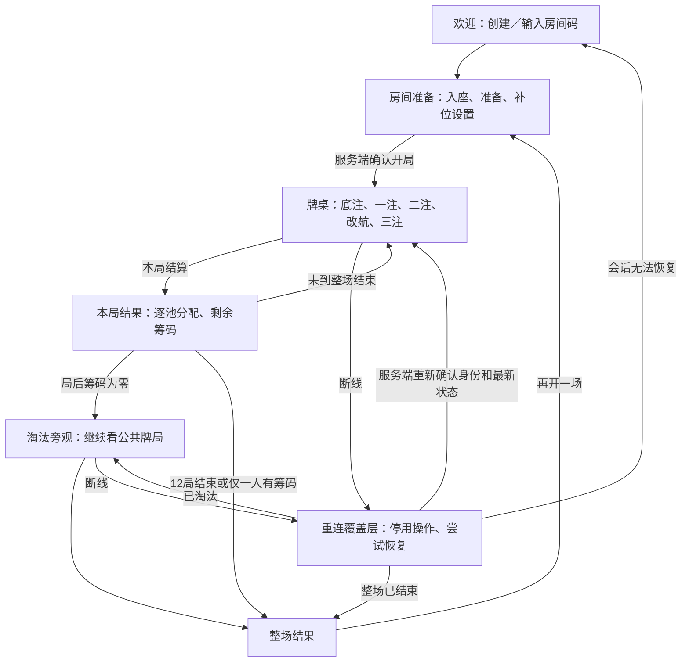

# 网页原型与验证设计

> 历史网页原型，当前方向见[技术设计 v0.2](../../../technical-design.md)。

日期：2026-10-09  
状态：设计稿；本阶段只定义页面、交互和验收，不创建或交付前端实现。  
规则依据：[标准牌局规则 v1.0](../../../standard-rules.md)。所有示例和界面均使用五人各 100、最多 12 局、底池限注、反向改航、实际顺位 5%→10% 的标准。

## 1. 产品假设与首版边界

**暂定以浏览器内的五人房间作为首个可交互原型，房间允许机器人补齐开局空座。用户尚未选择最终平台。** 这一假设用于把流程、联网语义和验收写具体；未来选择桌面或移动客户端时，规则、权限和服务端权威状态仍可复用。

首版的目标是让一名新玩家看懂两种行动方向、在合法额度内下注、按冻结费用改航，并完成一场可断线恢复的标准游戏。原型应能发现规则解释和交互问题，不承担证明游戏已经平衡的任务。

| 纳入原型 | 范围 |
| --- | --- |
| 欢迎与加入 | 使用临时昵称创建私人房间，或通过房间码加入；展示标准规则摘要 |
| 房间准备 | 五个固定座位、真人准备状态、房主配置机器人补位；准备期间可以调整空座，开局后成员和控制者固定 |
| 机器人 | 由服务端运行当前概率策略；界面标明机器人身份，不将其描述为会读人或已训练的智能对手 |
| 标准整场 | 12 局持续筹码、起始位轮换、前六局底注 1／后六局底注 2、提前结束 |
| 对局操作 | 合法下注、短额全下、主池／边池、反向改航、独立附加池、正式摊牌与逐池结算 |
| 记录与解释 | 本局公共动作历史、公开弃牌、费用及池资格说明；局后查看结果 |
| 连接恢复 | 恢复同一身份和座位，重新取得服务端状态；重复指令不会重复付款 |
| 旁观 | 本场被淘汰者自动转为公共信息旁观；无需新增一个可随意进入的公共观战大厅 |
| 再开一场 | 结算后由房主发起新的准备流程，新比赛生成独立标识；不在当前比赛中补筹码 |

首版不包含账号成长、商城、真钱玩法、赛事匹配、排行榜、聊天或语音、皮肤编辑器、3D 牌桌、录像导出编辑器、托管接管真人、对手手牌范围推断、胜率推荐面板及机器人训练。改航的动作记录会为以后的范围推断保留输入，但首版不声称实现这种推断。

机器人补位须由房主在准备页明确启用。房主确认开局时，空座按该设置填入机器人，真人须全部准备；开局请求是否成功由服务端决定。机器人不能挤占已入座真人，局中不接受新增参赛者。真人暂时断线不自动变为机器人，重新加入也不重置其筹码。

## 2. 页面与用户流



从重连覆盖层返回的页面由最新服务端状态决定，不强行回到断线前的牌局或阶段。欢迎页、房间准备页和结果页也能提示连接中断；此图重点展示会影响行动权的路径。

### 2.1 欢迎与房间准备

```text
暗潮航线
两张底牌，三张公牌。下注顺时针，改航反着来。

昵称 [____________]         [创建房间]
房间码 [__________]         [加入房间]

5 人 · 每人 100 · 最多 12 局        [查看规则]
```

```text
房间 K7M2                         规则：标准 v1.0

座位 0  林舟      真人  在线  已准备    房主
座位 1  沈岸      真人  在线  未准备
座位 2  空位
座位 3  空位
座位 4  空位

[✓] 开局时用机器人补齐空位          预计加入 3 位机器人

[准备]                             [开始游戏]
开始条件：真人全部准备，5 个座位已由真人或机器人占用
```

每个座位独立展示控制者类型 `controller_kind`（HUMAN／BOT）及在线状态 `presence`。真人“离线”仍是真人座位；机器人标签与网络在线标识不是同一属性。房间码分享仅复制链接或文字，不自动发送邀请消息。

### 2.2 牌桌布局与视角

服务端绝对座位 `seat_id` 在整场内固定为 0—4。玩家换成自己的本地视角，只旋转牌桌，不重排绝对座位，不将“我”写回座位 0。淘汰形成的空座保留位置；行动名单跳过失去资格的人。

本地显示约定：本人在底部，其他座位按原桌面的环形次序排列，绝不做镜像翻转。旁观状态沿用该玩家原视角；不同设备看到的屏幕位置可能不同，但动作中的座位和玩家身份相同。

下例本人是绝对座位 2，顺时针相邻次序为 2→3→4→0→1。图中数值仅用于说明排版，不代表一套待实现的实际状态。

```text
第 4 / 12 局  · 底注 1                        [规则] [公共历史]

         座位4 沈岸                          座位0 林舟
         真人 · 在线  筹码…                  真人 · 在线  筹码…
         [背面][背面]                        [背面][背面]

座位3 机器人                                                  座位1 渔火
机器人 · 筹码…             当前：改航                           真人 · 全下
[背面][背面]           [公位1][公位2][尚未揭开]                   [背面][背面]

                  普通池…  附加池…   [查看各池资格]
                  公开弃牌 [按被换出时间排列]

           本局下注起始顺序：0 → 1 → 2 → 3 → 4
           改航冻结顺序：4 → 3 → 2 → 0
           现在轮到：座位3；你的顺位：第3 / 4

                        座位2 你 · 真人 · 在线
                        [底牌1][底牌2]  可用筹码…
                        [当前阶段的行动区]
```

桌面上同时提供“下注：顺时针”与“改航：逆向”的文字；阶段进入改航后，强调实际冻结名单及当前行动者，不靠一个圆形箭头让玩家自行推断。下注顺序条说明首次行动方向，加注后的响应仍沿原下注方向；真正轮到谁，以服务端当前行动者为准。

普通牌背不表达对手花色、数字、强弱或将来结果。本人即使弃牌仍可看自己的已发底牌。对手全下继续显示牌背，直到服务端明确发布正式摊牌信息。弃牌者和未摊牌直接赢得奖金者，不因结果页打开而额外公开底牌。

### 2.3 下注行动区

行动区由服务端当前 `legal_actions` 驱动，客户端不能用余额自行推断可加注，也不能从“能全下”推断“有加价权”。没有待跟注额时展示“过牌”及合法开注；有待跟注额时展示“跟注／全下跟注”“弃牌”和合法加注。

```text
轮到你 · 需跟 6 · 可用 50                         剩余 18 秒

本次新增投入 [20]      [最小合法额] [半池] [最大合法额]
其中跟注 6，额外加价 14；你的本轮累计将到 24
合法新增范围 12—32

[弃牌]                  [跟注 6]                 [投入 20，加到 24]
```

“本次新增投入”包含跟注。按钮同时显示本次支出及自己的本轮目标累计：本人此前本轮已投 4，此次新增 20，目标累计为 24，而非 20。不能把服务端的 `max_add` 等本次金额直接标成“加到”。

数字输入和快捷按钮仅选择待提交数额；合法边界、允许短额全下以及是否有重新加价权，均由服务端提供。半池只是便捷选值，经过合法选项约束后明确展示实际金额；不能暗中把用户输入的越界金额改成另一笔交易。输入不合法时保留输入并解释原因，不可提交。

当只剩 5 枚却需跟 6 时，明确显示“全下跟注 5”，同时显示“只参与投入覆盖的奖池”。不要出现支付 6 的按钮。没有加价权时，不展示可借全下加注的入口。无需跟注且不能加注时，仅保留过牌。

### 2.4 改航行动区

```text
现在轮到你改航：第 3 / 4 位
本次费用 4（窗口开始时已冻结）    可用 28

选择公共位置： [公位1：三角7]   [公位2：圆形4]
已选公位1：将弃置当前的三角7，再随机揭开一张

[放弃本次改航]                             [支付 4，替换公位1]
```

费用来自冻结报价，不随着前人付款、放弃或换牌重新计算。点击“费用详情”才展开本人可争夺普通池、顺位费率、最低底注及取整说明，主操作区保留实际应付整数。

选择对象始终是公共牌位置 1 或 2，不是某张实体牌。历史中的“公位1曾为三角7”不能成为改掉旧牌的指令。若收到新权威状态时所选位置的牌或自己的行动权已经改变，清除旧选择并要求重新选择；第三张公共牌没有改航入口。

预览只说明“当前哪张会被公开弃置、需付多少、该附加池谁有资格”，不预测下一张牌、胜率或最终余额。点击发送后进入等待状态，立即阻止重复点击；牌面、余额和奖池仍保留上一次权威快照，直到服务端确认新的状态。不能为了动画先扣钱、先翻随机牌，再在拒绝时回滚。

费用超过余额时保留冻结顺位和报价，展示“余额不足，只能放弃”；名单不重新压缩。恰好够付时显示“支付后将全下，保留已有奖池资格”，实际全下标识仍等服务端确认。已全下者不出现在操作名单内，但仍显示在牌桌及有资格的池中。

### 2.5 公共行为历史

公共历史不是只列牌面结果。服务端确认的每次改航机会都形成可排序的公共记录，包含主动放弃、因不足额只能放弃以及超时放弃。自动原因应如实标注，避免将系统代行误读为玩家主动偏好。

| 记录字段 | 用户可见含义 |
| --- | --- |
| 整场、局号、阶段及事件顺序 | 可以重建“先下注、再改航、最后下注”的公开过程 |
| `actor` 与绝对座位 | 谁做了动作，不能只显示屏幕左侧／右侧 |
| 动作 | 改航／放弃；主动、超时或不足额等公开原因 |
| 位置 | 选择公共位置 1／2；放弃时为空 |
| 换出与换入 | 改航前后实际公开牌；放弃不伪造两张牌 |
| 实际顺位与窗口人数 | 例如第 2 / 4 位，使用冻结顺位 |
| 冻结报价与实际支付 | 放弃仍显示报价，实际支付为 0 |
| 附加池资格 | 付款时该费用对应的冻结资格名单 |

例：“座位3 机器人，第2/4位，支付3，公位1 三角7→方形2”；下一人再次替换公位1时追加一条记录，不覆盖上一条。例：“座位2 你，第3/4位，放弃，报价4，实付0”。

下注历史同样保留行动者、过／跟／加／弃、本次新增额和本轮目标。所有人能看见相同的公共动作；不把任何玩家未公开的底牌、机器人假想抽样或隐藏牌库写进公共历史。前端日志和错误报告也不能收集这些隐藏数据。

这套记录让人类可以判断“谁不喜欢哪张牌、谁愿意付费”。未来若实现范围推断，需要另行设计信念模型与评估；完整记录历史本身不代表机器人已经利用它。

### 2.6 本局、整场结算与淘汰旁观

```text
第 4 局已结算

主池 30       你 30               [看资格与分配]
边池 60       渔火 60
改航附加池 5  渔火 5             仅林舟、渔火有资格
退款          …                  未获跟注的超额部分

你：本局净变化 …，当前筹码 …
[查看本局公共过程]                下一局将在服务端倒计时后开始
```

以上为布局占位示例；具体奖金与同池赢家名单只接受服务端结算明细。普通池与附加池分别展示，必要时展开每个池的资格、赢家、均分额与余筹接收者。明确“本局获奖”与“本局净变化”不同，不能把拿到主池就标成全局唯一赢家。

出现正式摊牌时，可展示已公开底牌及所用最强三张；直接结算独得池时不额外亮底牌。并列整场冠军正常展示多人，不自行用花色或座位破同分。

局中可用筹码为 0 显示“全下，等待有资格奖池结算”。仅在全部退款和普通／附加池结算后，服务端认定筹码仍为 0，才显示“已淘汰，继续旁观”。旁观者没有下注和改航控件；仍能看公牌、公开历史、已正式摊开的牌和整场进度，不能看其他人的隐藏底牌。

## 3. 指令、等待与恢复状态

### 3.1 单一权威快照

前端游戏领域状态由一个 reducer 接收完整、面向当前身份过滤的快照。唯一权威版本 `state_revision` 位于外层 `RoomSnapshot`，在整个房间生命周期内递增，跨整场比赛不重置；内层 `MatchState` 不另存可重置版本。使用该版本判断新旧并整体替换快照，避免把不同版本的公牌、余额、合法动作拼在一起。

准备、开局、游戏动作及成功认领控制权（`controller.claim`）都会提高 `state_revision`；控制权交接同时提高 `controller_epoch`，但保留原行动机会的 `turn_id` 和期限。临时在线状态使用独立的 presence／连接序号；仅断线、重新上线或心跳不提高 `state_revision`。因此在线提示刷新本身不会使游戏指令过期，实际控制权变更后则必须等待新版快照再提交。

`state_revision`、`event_seq` 和 `controller_epoch` 在数据库中使用非负 `BIGINT`，线上 JSON 使用规范的十进制字符串；引用它们的 `expected_revision` 等字段沿用同一表示。前端以 `BigInt`，或经校验的十进制数值比较（先比位数，相同位数再比字符）排序；不能直接对字符串做字典序比较，也不能转成可能丢失精度的 JavaScript `Number`。线上对象保留字符串，或发送前明确将内部 `BigInt` 转回十进制字符串，不直接对含 `BigInt` 的对象调用 `JSON.stringify`。事件序号与状态版本各自单调，一次版本提交可能产生多个事件，不能互相代替。

指令使用 `command_id`、`turn_id` 与 `expected_revision`。这些是与后端对齐的契约要求，具体消息类型和连接控制权机制由后端设计定义。前端不向玩家暴露这些标识。

- 旧版本快照不覆盖新版本；重复版本不再次执行动画或重复记历史。
- 完整快照可跨越中间版本直接更新；不能仅因revision跳号就拒绝一份更新的完整状态。若只收到不完整增量或状态彼此矛盾，则请求最新完整快照，期间停用行动按钮；仅公共历史缺页时补取历史，不把缺页记录伪造为已发生动作。
- 相同 `command_id` 的网络重试属于同一笔动作，不生成第二笔付款。
- 收到成功回执但尚未收到新快照时，仍等待权威状态；收到拒绝则保留已确认余额并请求／应用最新状态。
- 重新连接先确认原身份、同一绝对座位和当前控制权，再恢复按钮。重复标签页谁可控制由服务端决定，其余标签页只读提示。
- 第 12 局已结束或已淘汰时，重连直接显示当前结果或旁观页面，不让旧行动浮层继续提交。

Zustand 如采用，仅保存面板展开、选中公共位置、待提交金额、声音偏好等 UI 状态。筹码、牌面、资格、当前行动者、冻结报价和合法动作不在 UI store 中维护第二份可写副本。

### 3.2 行动区状态

| 状态 | 界面行为 | 离开条件 |
| --- | --- | --- |
| 等待其他人 | 显示当前行动者及方向，操作区只读 | 最新快照轮到本人 |
| 本人可操作 | 按 `legal_actions` 展示选项和额度，允许本地选择 | 发送指令或新快照撤销行动权 |
| 已发送等待 | 按钮显示“正在提交”，禁止第二次动作；筹码与牌面不提前变 | 服务端回执和最新快照确认／拒绝 |
| 状态已过期 | 说明“牌局已推进，正在刷新”，清除失效输入 | 新权威快照到达 |
| 连接中断 | 覆盖层显示最后状态与重连进度，禁用所有动作 | 服务端恢复身份和控制权 |
| 淘汰旁观 | 显示旁观标识，无参与控件 | 整场结果或离开 |
| 整场结束 | 最终筹码、并列冠军及再开一场入口 | 新比赛准备成功 |

等待期间即使超过本地估算倒计时，也不能自行执行弃牌、放弃、结算或扣筹码。服务端期限决定真实结果；客户端倒计时只负责展示。

### 3.3 断线与超时的暂定产品策略

暂定不中断全桌时钟。到达服务端期限时：可免费过牌则过牌，否则弃牌；改航则放弃。该策略属于房间产品设计，不修改标准牌型和资金规则，应在房间准备页告知。行动时长参数、可否在正式产品提供延时，尚未定稿，不在原型内宣称已经确定。

断线恢复保留已扣费用、已确认动作和已经到期的自动动作；不允许“重连撤销坏结果”。网络层重试复用原 `command_id`。如果发送后失去响应，应先恢复权威状态或查原指令结果，再决定是否重传，不让玩家通过再次点击生成另一笔改航。

## 4. 前端技术选择与可访问性

采用 React + TypeScript + Vite 作为暂定原型栈。卡牌使用 SVG 或 CSS 与真实文字数字绘制，花色使用三种形状加名称；牌桌、按钮和面板使用常规 DOM。当前交互无需 Canvas 或 WebGL，也不依赖生成图片才能表达规则。

建议组件边界：应用入口与连接提示、准备房间、牌桌、座位、公共牌区、本人底牌、奖池列表、行动区、公共历史、本局结果、整场结果。组件只展示从同一快照派生的状态；规则计算和合法性不散落在各按钮内部。

| 方面 | 要求 |
| --- | --- |
| 桌面 | 五座环形布局，当前方向与行动区始终可见，历史可侧栏展开 |
| 窄屏 | 保留三张公共位置及本人行动区，其他座位压缩为稳定的环形／分组信息；历史与池明细使用可展开面板，不挤走提交按钮 |
| 目标宽度 | 360 CSS px 下可读可操作；不依赖横向滚动完成下注或改航 |
| 键盘 | 能按逻辑顺序进入金额输入、选择公共位置、展开明细和提交；有明显焦点，不能通过未聚焦全局按键误下注 |
| 提交安全 | Enter 只在明确的表单操作上下文提交；弹层打开时不把按键透传到桌面；发送等待中快捷键同样失效 |
| 色弱 | 三种花色同时有形状和可读名称；当前轮次、全下、弃牌、离线不只依靠颜色区分 |
| 读屏 | 牌有花色与点数名称，背面只读“隐藏底牌”；阶段与行动确认可通知，倒计时不每秒打断朗读 |
| 动画 | 翻牌、移筹码均在权威事件后表现；允许减少动态效果，跳过动画不会改变状态或阻挡下一次合法操作 |
| 字号与触控 | 金额、费用和按钮文案允许系统放大；触控目标建议至少 44×44 CSS px |

## 5. 文档场景数据

以下仅是未来低保真联调与验收的输入表，不是已实现的 fixture、接口响应或测试代码。参与者用固定绝对座位识别；示例只给该场景必要字段。

| 编号 | 已确认的公开状态／本人信息 | 应呈现与允许的行为 |
| --- | --- | --- |
| P01 准备补位 | 2 真人在线并准备，3 空座；房主启用补位 | 提示开局加入 3 位机器人；服务端确认前仍是准备页，不提前发牌 |
| P02 本次与累计 | 普通池 P=20；本人本轮已投 4，待跟 C=6；余额 50；本次完整加注最小 12，最大 32 | 选新增 20 时显示“含跟6、加价14、本轮累计24”；不能写“加到20” |
| P03 无重新加价权 | 本人面对短额全下尚未恢复加价权；待跟 5，余额 80 | 只呈现跟5／弃牌；有余额不代表能加注，也不显示全下加价捷径 |
| P04 反向与冻结 | 本局下注 A→B→C→D→E；五人 E 均40，底注1 | 改航 E→D→C→B→A，报价2/3/3/4/4；E付款后 D报价仍3 |
| P05 报价后不足额 | 冻结列表 D→C→A；C 余额2、报价3 | C 仍是第2/3位，只能放弃；A仍第3位且报价不变，不重排到第2位 |
| P06 同位再次替换 | D已将公位1 三角7换成圆形6；当前轮到C | C可选择公位1，确认文案写圆形6；历史保留三角7→圆形6，再追加第二次替换 |
| P07 全下保留隐藏 | A普通贡献10、余额0；B/C各贡献30；A未弃牌 | 主池30含A/B/C，边池40仅B/C；A显示全下与牌背，不显示淘汰，不进改航名单 |
| P08 附加池不买资格 | A/B各贡献40且有余额；C贡献10后全下；B支付费用5 | 主池30为A/B/C，边池60为A/B，附加池5仅A/B；普通贡献仍40/40/10 |
| P09 待确认重复点击 | 已发送支付4改公位1，尚无成功状态；随后连接中断 | 不扣显示余额、不揭替换牌、不再允许新提交；恢复后以原command结果与快照为准 |
| P10 旧快照迟到 | 已呈现revision43，后收到revision42；presence另有刷新 | 游戏状态保持43；在线提示按其独立序号更新，不回滚或使操作因presence变化失效 |
| P11 退款恢复行动 | 玩家先投入全部余额，随后收到未获跟注的退款6；新状态余额6、未弃牌 | 不因曾标全下永久禁用；仅按新legal_actions显示后续合法操作 |
| P12 淘汰与局数 | 第6局全部奖金结清，本人0筹码；尚有多人有筹码 | 转旁观，第7局底注升2；不重新发本人底牌，不给补100入口 |
| P13 最后并列 | 第12局所有奖池及余筹分完，两人最高筹码相等 | 显示两位并列冠军，不按花色或座位判唯一赢家；总筹码仍500 |

## 6. 验证矩阵与通过标准

已有模拟工作曾报告 **103 项规则与统计测试**。这些测试、[标准规则](../../../standard-rules.md)及已保存的确定性牌局可作为将来产品规则实现的对照依据（oracle），不能证明房间服务、权限隔离、网络重试、浏览器交互或上线运维已经完成。本设计阶段不创建或执行新的实现测试，也不把历史测试数量作为发布验收。

| 层次 | 必测场景 | 可核查的通过标准 |
| --- | --- | --- |
| 规则一致性 | 牌型优先级、至少一张底牌、顺子不环绕、12局底注变化 | 产品规则结果与标准及选定确定性参考牌局一致；不得沿用历史引擎默认正向改航配置 |
| 下注权利 | 本次含call、目标累计、完整加价、连续短全下、底池上限、超额退款 | 前端只提交服务端许可的动作；服务端拒绝越界指令且不改变资金；P02/P03/P11解释一致 |
| 改航 | 名单反向、费用冻结、同位多次替换、付不起／恰好付清、单人仍可操作 | 顺位与费用不因pass前移；位置和实际牌一致；付清前不揭新牌；资格按规则执行 |
| 分池 | 多层全下、弃牌死钱、附加池资格、多个同资格层合并、平局余筹 | 普通贡献与费用分账；每池只给合资格者；全部结算后总筹码500，整数余筹不丢失 |
| 私密信息 | 本人、其他真人、机器人、全下者、弃牌者、淘汰旁观者分别接收状态 | 网络载荷中不存在当前身份无权查看的底牌或牌库；仅CSS隐藏不算通过 |
| 指令一致性 | 双击、同command重试、旧turn、旧revision、并发标签页 | 至多一次生效；拒绝有明确原因；无重复支付、越权行动或被旧消息回滚 |
| 断线恢复 | 提交前、提交后回执前、付款后翻牌前、结算中、换局、淘汰后断线 | 恢复同一身份和当前权威状态；已确认动作不撤销，旧动作不在新局执行 |
| 公开历史 | 改航／主动pass／自动pass、重复槽位、超时、下注目标变化 | actor、顺位、费用、牌面变化可按确认顺序重建；无虚构记录、丢失确认动作或隐藏信息泄露 |
| 房间流程 | 空座补位、准备撤销、房主操作、满房加入、局中加入、再开一场 | 原比赛不新增参赛者、不补筹码；机器人／真人控制者状态明确；新比赛标识独立 |
| 页面完整性 | 完整12局、提前结束、全下后赢回、局后淘汰、并列冠军 | 每条状态流有可返回的页面，结果与桌面金额一致，无永远等待或误淘汰 |
| 可访问性 | 窄屏、键盘、色弱、读屏、减少动画、字体放大 | 不依赖颜色完成选择；360px能操作；键盘无误提交；动画不改变时序与合法动作 |
| 真人理解 | 邀请少量首次接触者使用规则摘要完成试玩 | 能用自己的话区分下注与改航顺序、全下与淘汰、本次与累计、主池与边池；记录误解点及完成任务所需提示 |

真人试玩不以“看起来好玩”单句作为通过。至少记录：完成第一局前的求助次数、误解费用的次数、是否误把全下当淘汰、是否以为看到替换结果后可撤销、是否理解自己的获奖资格。人数、时长和定量阈值在安排试玩时确定，不为尚未发生的测试填入成绩。

## 7. 开发里程碑与完成定义

下面是未来获得实现任务后的顺序，不表示本轮已开始开发。

| 里程碑 | 产出 | 完成定义 |
| --- | --- | --- |
| M0 设计对齐 | 本文、后端状态与协议设计、当前标准规则之间的对应表 | 无下注金额、改航时序、费用归属和隐藏信息冲突；平台／房间身份／超时参数的暂定项有明确标记 |
| M1 可核验规则服务 | 一套权威状态转换和面向身份的观察接口 | 关键历史参考局逐步对齐；非法动作无副作用；规则标准配置显式锁定；资金与牌库守恒通过 |
| M2 最小房间与恢复 | 创建／加入／准备／机器人补位、指令确认、断线重连 | 两个真人客户端与机器人可完成同一场；重复命令不重复扣款，身份隔离和旧消息测试通过 |
| M3 全流程低保真前端 | 欢迎、准备、桌面、两类行动区、逐池结算、旁观 | P01—P13都有可演示路径；所有金额与牌面来自权威状态；未授权隐藏牌不下发 |
| M4 联网与体验验收 | 验证矩阵的执行记录、发现问题及修正记录 | 主流程、资金、隐私、超时和恢复没有未解决阻断项；键盘及窄屏可完成一局；真人误解有具体修正 |
| M5 可交付试玩版 | 有版本号的运行包／测试环境及简短使用说明 | 可从准备到终局稳定复现，明确“试玩原型”；部署与运行验收独立完成后才称可供外部使用 |

“规则模拟可运行”“页面已经绘制”“局域网能玩一局”分别只满足部分里程碑。最终原型完成需同时具备规则正确、身份隔离、指令一致、恢复可用、完整流程和可理解的操作反馈。对局平衡、行为推断能力及大规模线上运行能力不随原型验收自动成立。
