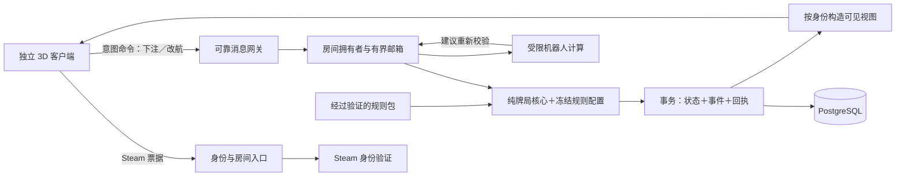

# 《暗潮航线》独立客户端与在线牌局后端设计

版本：设计稿 v0.2 · 2026-10-09  
产品方向：独立 3D 客户端、多人在线、面向 Steam 发行、支持受控 Mod。  
范围：当前细化牌局后端；客户端只确定责任边界与联调要求。本轮只更新设计文档。

规则依据：[标准牌局规则 v1.0](standard-rules.md)。技术版本 v0.2 不修改标准玩法。[历史技术设计 v0.1](archive/technical-v0.1/technical-design.md)已归档。

## 1. 对 v0.1 选择的修正

v0.1 假设先用网页验证规则，Python 主要因为已有模拟资产、便于概率研究且回合制负载较轻。这个选择能够支撑一种原型，但没有充分纳入独立 3D 游戏、Steam 身份、长期运营、Mod 信任边界及生产故障接管，因此不应直接当作发行版架构。

Python 可以服务独立客户端，也可以运行稳定的联网服务；3D 本身不要求服务器改用某种语言。此次调整依据是未来工程边界与维护成本。保留 v0.1 的整数账本、单房间顺序裁决、持久化后发布、隐藏信息投影及确定性回放，替换其网页产品假设、访客 Cookie 身份与 Python 产品后端默认方案。

## 2. 当前推荐及语言取舍

**推荐 C#／.NET 10 LTS 实现独立、无图形的权威牌局服务器，PostgreSQL 持久化，Python 保留为离线概率与规则研究工具。** 这是当前设计推荐，尚未创建工程或完成性能验证。

| 候选 | 适合本项目的部分 | 需要承担的成本 | 本轮决定 |
| --- | --- | --- | --- |
| Python | 已有模拟与精确概率工具；低频回合制吞吐可以满足一定规模 | 大量状态契约更多依赖运行期检查；CPU 策略需单独调度；对象与进程开销需要管理 | 保留离线研究与迁移对照，不默认承担长期生产裁决 |
| C#／.NET | 静态类型、成熟异步与网络库、跨平台无图形部署、诊断与测试工具；可用清楚的小型状态模型表达规则 | GC／分配仍要测；需迁移现有 Python 规则；不能把加载程序集当成安全 Mod 沙箱 | 后端推荐 |
| Go | 部署与并发模型直接，适合独立服务 | 游戏规则与未来客户端工具通常是另一套语言边界；仍需设计受控扩展 | 同等可行备选，若团队主要熟悉 Go 可重评 |
| Rust | 内存控制与类型约束强，适合明确的资源与隔离需求 | 开发与异步整合成本较高；本牌局尚无测量证明需要承担它 | 不作为当前默认 |
| Unreal C++／完整引擎专服 | 若规则依赖真实物理、移动命中或引擎世界状态，可直接复用权威模拟 | 每实例加载世界的成本及引擎生命周期会进入后端；当前牌局无此需求 | 客户端可选 Unreal，牌局核心暂不绑定引擎 |

选择 C# 不等于已经选择 Unity。Unity、Unreal 或其他客户端都可以通过同一版本化协议连接。即使以后选择 Unity，也不能假设 `net10.0` 程序集可以直接放进 Unity／IL2CPP；可共享规则规范和生成消息，库共享须单独验证运行时兼容性。

这不是基于“Python 不够快”的否定：27 张牌的规则计算很轻，主要工程压力在并发状态、持久化、恢复和资源隔离。若团队已有成熟的 Python 生产运营经验，这项经验可以超过改语言的收益。当前在尚未绑定团队技术栈的前提下推荐 C#；静态类型仍不能替代对网络输入的运行期校验。

ASP.NET Core 在这里承担身份入口和网络网关，不表示产品是网页。可靠 WSS 同样可服务原生客户端。牌局每秒动作很少，先用可靠有序消息；未来需要角色移动、语音或表情同步时，再为这些流设计相应传输与服务。

.NET 官方支持表将 .NET 10 标为 LTS，支持期至 2028-11-14。采用受支持版本有利于补丁维护，但需要持续更新补丁及规划升级，并不自动得到稳定性。[官方支持政策](https://dotnet.microsoft.com/en-us/platform/support/policy/dotnet-core)

## 3. 客户端、服务器与 Steam 的边界

| 部分 | 负责 | 信任边界 |
| --- | --- | --- |
| 3D 客户端 | 模型、镜头、角色、动画、输入、可见牌面展示 | 可以被玩家修改；提交动作意图，不能确定牌序、金额与胜负 |
| 牌局核心 | 发牌顺序消费、合法动作、报价冻结、分池、派奖、12 局推进 | 只消费明确输入，不访问网络、引擎场景、时钟或外部脚本 |
| 房间执行层 | 身份、期限、顺序、所有权、提交及恢复 | 当前有权拥有者才可提交；旧节点由数据库拒绝写入 |
| Steam 集成 | 身份／持有权验证，按产品需要接入邀请、大厅与分发 | Steam 大厅或客户端报告不替代牌局账本；AppID 与发行配置须在接入阶段验证 |
| 官方标准房 | 官方规则包与官方服务器裁决 | 标准规则结果可进入官方记录；开局后包与配置不可替换 |
| 自定义房 | 明示参数／内容包与权限边界 | 自定义结果与标准结果隔离；社区自托管若开放，必须标明服主可控制服务器 |

桌上牌的物理姿态不能决定其数字，动画播放完成也不能作为提交成功条件。客户端可落后、跳过或重建动画，服务器已确认的费用和结果保持可恢复。

专用服务器需要持续的计算、数据库、带宽和运维投入；它把完整隐藏牌局留在官方控制的环境，避免玩家房主通过读取本机服务器内存看到全牌。未来若提供玩家自托管模式，应明确采用另一种信任等级，不能同时承诺与官方标准房相同的防房主作弊能力。

## 4. 后端模块与技术栈

先读[架构总览：连接、房间与牌局](technical/架构总览-连接房间与牌局.md)，其中按八项核心职责解释模块输入输出、登录未入房、成员绑定、开局结算和掉线重连。模块是代码职责，不等于需要独立部署同等数量的服务。

| 模块 | 推荐技术与职责 |
| --- | --- |
| Domain | C# 纯类库；明确枚举和强类型标识，小型候选状态，整数账本；不引用 UnityEngine、Unreal 或数据库驱动 |
| RoomRuntime | .NET 异步任务＋有界 Channel；每房间单一消费者；系统期限事件与玩家命令按已定义顺序处理 |
| Gateway | ASP.NET Core／Kestrel；HTTPS 身份入口、WSS 二进制消息；控制台或原生测试客户端可联调 |
| Contract | 版本化 Protobuf，限制解码深度和集合长度；业务 DTO 与私有快照结构分开，未知行动类型拒绝 |
| Persistence | PostgreSQL＋Npgsql；状态、事件、命令回执在短事务内提交；迁移显式版本化 |
| RulePackages | 包清单、能力版本、配置规范化摘要、不可变内容存储；首阶段参数配置，无任意玩家 DLL |
| BotWorkers | 有界任务执行器；与核心独立预算，只接收机器人可见观察；失控任务不拖住房间 |
| Operations | 结构化脱敏日志、指标与追踪、节点排空、备份恢复、灰度与回滚；核心指标见容量文档 |
| OfflineResearch | 现有 Python 模拟、概率枚举、平衡实验；作为候选行为参考，经标准规则核对后形成迁移金样 |

初期可以使用一个模块化服务器程序部署多个实例，不要求拆成大量微服务。生产设计必须覆盖多实例归属和故障恢复；不能把“启动两个 worker”误认为完成高可用。牌局进程不加载 3D 模型、纹理或声音。

## 5. 规则状态和资金设计保留什么

标准配置仍是五席、27 张牌、各 100 枚、最多 12 局、两底三公、反向改航及 5%→10% 冻结报价。规则包允许的参数能力与标准配置分开；标准的总筹码 500 不能被误当成未来所有自定义房的全局常量。

- 标准牌／座位可用 byte，资格用小位掩码；枚举显式赋值，协议与持久格式各自版本化。
- 筹码使用 int32 及严格范围校验，中间乘法／求和使用 checked int64；标准总量校验为 500，自定义房从开局冻结的配置计算总量。
- RoomSnapshot 外层拥有单一递增 state_revision，规则核心持有 MatchState／HandState／BettingRoundState／SwapWindowState。
- 普通贡献、冻结报价与费用附加池分别记录；全下、可跟金额和可行动名单从权威事实推导。
- 每条合法命令产生独立候选状态；在事务成功后才公布换牌或结果。重试查原回执，避免重新扣款或重新洗牌。
- 回放绑定规则配置摘要、引擎构建版本、快照格式与随机算法版本；真实牌序私有保存，不能仅靠某个语言默认随机种子重建。

完整字段、状态转换及筹码不变量见[领域与规则引擎](technical/domain-and-engine.md)。固定大小集合不意味着 C# 数组自动不可变；所有权和复制边界必须显式约束。

## 6. 稳定性通过哪些机制建立

| 故障或竞争 | 设计行为 |
| --- | --- |
| 重复点击、重传或成功回执丢失 | 同一命令只提交一次效果；同 ID 不同内容拒绝 |
| 一个节点宕机或网络分区 | 后继节点按数据库租约接管，增加 owner_epoch；过期拥有者不能提交 |
| 提交结果未知 | 冻结相关房间写入，查询回执和最新状态确认，不猜测成功或再扣款 |
| 服务端中断恰好跨过行动期限 | 持久恢复状态和剩余预算；恢复计时有明确误差和补偿上限，不将系统故障静默记为玩家弃牌 |
| 单个玩家断线 | 同一身份恢复；正常行动期限继续，避免一人断网拖住全桌 |
| 数据库故障 | 暂停权威推进；只有具备相应持久化配置及演练证据才承诺恢复点目标 |
| 某个机器人、Mod 或慢连接异常 | 有界队列、任务预算与隔离；不让一房或一连接拖垮其他房间 |
| 更新服务器或内容 | 新房使用新版本，旧房按原包结束或显式迁移；先排空，再替换，失败可回滚 |

生产验收建议以月度 99.9% 自有牌局服务可用性、普通动作确认 p95＜200 ms／p99＜500 ms（不含公网）、单节点失效恢复目标 30 秒内为讨论起点。全部是待验证目标；统计口径、依赖失败、恢复时长和压力负载需一并记录。已经回复成功的动作在应用节点故障下应可恢复；数据库节点故障能否做到同样效果，取决于 WAL 持久性、同步副本确认及防双主流程，不能凭“用了 PostgreSQL”承诺 RPO 为零。

细节见[协议、并发与故障恢复](technical/protocol-and-concurrency.md)及[容量与发行前验证](technical/capacity-and-storage.md)。

## 7. Mod 扩展与防作弊共同设计

当前首选“官方标准规则包＋受验证的参数规则包＋被动表现资源”。官方托管的自定义参数房是可控的第一步；任意脚本与社区自托管是后续独立能力。

参数规则包 v1 保持五席、27 牌及两底三公拓扑，建议允许初始筹码 1…10000／席、局数 1…100、逐局底注、费率、改航方向及六类牌型强度排列。边界是工程能力提案，需要相应测试后开放；标准房继续使用标准 v1.0。改变牌库或人数需要新能力版本及算法／容量复核。

Workshop 是发布与获取内容的渠道，订阅 ID 不是安全证明。入房和开局须匹配具体内容摘要、依赖、能力与配置；服务器选择并验证实际生效的规则。第三方内容无法因带有签名或摘要就自动成为可信代码。

官方服务器负责所有隐藏信息与规则裁决。对手底牌、未抽牌序和秘密随机状态从不进入无权客户端，客户端 Mod 因而不能通过读取内存直接看到它们。服务器拒绝越权、越额、旧回合和重放命令。剩余风险还包括玩家串通、读屏策略辅助和恶意房主服务器；这些不能靠语言、混淆或反作弊 SDK 一次消除，应明确模式边界、审计及处理依据。

未来脚本能力应采用受限制的确定性执行环境及进程／操作系统边界，按 hook 提供最少数据，限制 CPU、内存、输出和主机调用。程序集加载隔离不等于安全沙箱。详见[Mod 与防作弊设计](technical/mods-and-security.md)。

## 8. 当前交付与后续验证顺序

| 文档 | 范围 |
| --- | --- |
| [领域与规则引擎](technical/domain-and-engine.md) | 字段、常量、状态、财务不变量、C# 表示、可暂停迁移及规则配置 |
| [协议、并发与恢复](technical/protocol-and-concurrency.md) | Steam 身份、命令、租约与 fencing、持久化、期限、接管与重连 |
| [Mod 与防作弊](technical/mods-and-security.md) | 内容／代码信任、受控扩展、权限、版本及安全验收 |
| [容量与发行前验证](technical/capacity-and-storage.md) | 资源上限、压力场景、可靠性目标、备份恢复及发布门槛 |
| [客户端边界与后端验证原型](technical/prototype-and-validation.md) | 3D 与牌局的边界、无需美术即可验证的后端原型、未来客户端联调 |

建议次序：冻结领域契约与规则金样 → 单步 C# 核心及性质测试 → 持久命令与双节点故障测试 → Steam 身份和最小原生客户端联调 → 有界参数 Mod → 安全／负载／恢复验收 → 3D 制作与发行整合。图形制作可由独立流程安排，不阻止牌局后端验证，也不要求现在决定建模管线。

Steam 发行是产品与交付目标，不是一种后端语言认证。接入 Steamworks、构建／更新、联机支持、内容权限和实际发行审核均需分别完成；本设计不声称已获得认证或具备上线容量。

参考：除 .NET 支持政策外，本轮核对了 Steam 官方[身份验证](https://partner.steamgames.com/doc/features/auth)与[Steam Datagram Relay](https://partner.steamgames.com/doc/features/multiplayer/steamdatagramrelay)说明。SDR 需独立集成与部署验证，普通 WSS 不会自动经过它；传输保护不替代游戏规则校验。
