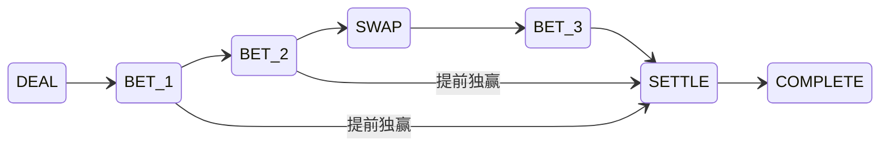

# 领域数据与规则引擎设计

版本：设计稿 v0.2 · 2026-10-09。面向独立 3D 客户端、Steam 发行与权威联机服务器；本文规定数据、规则状态迁移、受限规则 Mod 和验证边界，不代表已实现接口。先前 Python／网页方案保存在 [v0.1 存档](../archive/technical-v0.1/technical/domain-and-engine.md)。

标准玩法依据为 [《暗潮航线》标准牌局规则 v1.0](../standard-rules.md)。同一纯规则核心驱动真人房间、机器人模拟和确定性回放。`STANDARD_V1` 是其中一个冻结的规则 profile；五席、27 张牌和标准总筹码 500 的适用范围在下文明确。玩家淘汰后不压缩席位编号。

实现约束补充：**牌桌总座位数、本局参与人数、参与座位顺序必须分别处理。** 基础发牌组件已支持配置 2～8 个总座位，并按显式参与名单发牌；名单可以不连续，未参与座位保留编号和空手牌。玩家是否空座、淘汰或旁观由上层状态确定，不能把座位容量当成存活人数。下文五席的数组长度、掩码范围与资源估计适用于现行标准／参数 profile，不能写成基础组件的全局容量限制。开放其他人数的完整赛制时，仍需更新对应 profile、协议边界与最坏容量验证；目前完成范围见[开发进度](../开发进度.md)。

## 1. 核心约束与模块边界

权威服务端建议使用 **C#／.NET 10 LTS**，规则核心是无 Unity／Unreal 依赖的普通 .NET 类库。核心只依赖约定的值类型、短数组和整数运算，不使用 `UnityEngine`、场景对象、物理引擎、帧时间、Steam SDK 或网络组件。3D 牌桌只负责呈现和提交意图，服务器无需运行 3D 场景或逐帧游戏循环。

状态采用不可变语义：一次动作构建独立候选状态，成功提交后替换当前快照。可使用值类型、`ImmutableArray<T>` 或封装后防御性复制的小数组；不能因为外层是 `record`、属性是 `init` 或数组字段是 `readonly`，就声称数组元素不可变。普通 `record` 的 `with` 复制也会共享嵌套数组；任何仍可修改的缓冲区都必须在候选写入前取得独占副本。

服务端 `.NET 10` 目标程序集不自动兼容 Unity 的脚本运行时或 IL2CPP。客户端若需要离线练习或动作预览，可在实现阶段验证一个独立的兼容构建目标；线上最终结果仍由服务器决定。为共享源码而降低服务器运行时版本、依赖 Unity 程序集或信任客户端结算，都不是本设计的前提。

规则核心接收冻结的 `RuleProfile`、经过身份解析的命令和当前状态，输出候选状态、领域事件及下一项等待条件。它不拥有 WebSocket、HTTP 会话、Steam 身份票据、用户名、认证令牌、数据库连接、系统时钟或机器人线程。

| 层 | 负责 | 不放入规则状态的内容 |
| --- | --- | --- |
| 房间与席位 | 加入、准备、席位与参与者身份的绑定、确认规则包、开始新整场 | 底牌计算和下注判定 |
| 整场与牌局 | profile 规定的局数、筹码、牌库、下注、改航、分池、结算 | 在线状态、网络重连状态 |
| 房间执行器 | 串行接收命令，安排计时和机器人工作，持久化后发布结果 | 自行修改金额、手牌或获奖资格 |
| 连接与展示 | 将私有状态投影为某个观看者能看到的数据，发送更新 | 以客户端状态作为游戏事实来源 |
| 策略工作进程 | 读取与该机器人同等权限的观察，返回动作建议 | 获得真实牌库、其他底牌或直接写入房间状态 |

一次动作的流程为：

`当前状态 → 验证命令 → 生成候选状态与事件 → 校验不变量 → 持久化成功 → 替换内存状态 → 向各观看者发布投影`

持久化失败时保留旧状态，不先发布一个尚未成功记录的结果。客户端确认、动画结束、连接恢复都不应直接推进牌局。

## 2. 基础类型、标准 profile 与受限 Mod

下表指定领域内部 C# 类型。Protobuf 编码长度、CLR 对象总占用和原始数组大小是不同概念；不能把 varint 字节数当成整个对象的内存。领域类型也不直接复用可变的 Protobuf 生成消息。

| 名称 | 领域类型与范围 | 紧凑编码参考 | 约束 |
| --- | --- | --- | --- |
| `Seat` | `byte`；当前能力范围 0…4 | 原始值 1 字节 | 表示整场固定席位，不是当前行动顺位 |
| `SeatMask` | `byte`；当前范围 0…31 | 原始值 1 字节 | 第 p 位代表席位 p，拒绝能力范围之外的高位 |
| `CardId` | `byte`；当前牌库范围 0…26 | 原始值 1 字节 | C# 整数运算 `suit = id / 9`，`rank = id % 9 + 1` |
| `CardMask` | `uint`；仅使用最低 27 位 | 原始值 4 字节 | 用于去重、未知牌集合；不是另一份牌库 |
| `Suit` | 底层为 `byte` 的枚举 | 原始值 1 字节 | `RED=0, BLUE=1, GREEN=2`；花色不参与胜负排序 |
| `Chips` | `int`；`0…profile.TotalChips` | 原始值 4 字节 | 标准总量 500；参数 Mod 当前最多 50000；所有实存金额受冻结总量约束 |
| `SeatChips` | 长度等于 `profile.SeatCount` 的固定小数组；当前为 5 | 五个 `int` 原始值 20 字节 | 不可变语义、按绝对席位索引；数组头另计 |
| `HandIndex` | `int`；`1…profile.MaxHands` | 原始值 4 字节 | 标准 1…12；参数 Mod 当前最多 100；尚未开局用独立状态表示 |
| `BasisPoints` | `int`；当前允许 0…10000 | 原始值 4 字节 | 标准首末 500／1000；实际费用仍有最低底注 |
| `state_revision` | 非负 `long`；`0…2⁶³−1` | 有符号 64 位 | 对应 PostgreSQL `bigint` 和 Protobuf `int64`；`RoomSnapshot` 唯一版本，跨整场不重置，presence 不递增 |
| `turn_id` | `Guid`／UUID | UUID 固定 16 字节 | 输入机会首次建立时生成并持久化；重连、控制权转移不重建；wire 统一 UUID 编码顺序 |
| `command_id` | `Guid`／UUID | UUID 固定 16 字节 | 用于重试去重；不能替代权限和版本校验 |

Protobuf 边界完成长度、枚举、非负金额、席位及牌号范围校验，再转换成领域值；未知命令、非法枚举及超出能力范围的高位不得静默截断。版本直接使用非负 64 位整数，不需要网页时代为 JavaScript 转十进制字符串的安排；递增必须检查溢出，不能回绕或跨整场重置。UUID 在线上固定为协议规定的 16 字节 RFC 顺序，调试时才格式化为规范字符串，不依赖 `Guid.ToByteArray()` 的默认布局作为跨语言协议。

范围 `0…TotalChips` 约束实存金额，不约束尚未截断的计算中间值。例如 `P+2C` 可大于总筹码，费用分子还要乘费率和人数因子。计算先显式提升为 `long`，在 `checked` 上下文中进行乘法、加法、求和及向上取整，校验结果再转换为 `int`。不能先用 `int` 相乘发生溢出，再把错误值转成 `long`。金额不使用浮点数；最低加价幅度等中间规则数也使用有界整数，不强行塞进实存金额的范围。

### 2.1 标准规则 profile

产品定义独立的不可变 `STANDARD_V1`，至少锁定以下值。它们是标准玩法的事实，不是对所有未来 Mod 硬编码的全局常量：

| 常量 | 值 |
| --- | --- |
| `RULESET_ID` | `dark-tide-standard-1.0` |
| `RULESET_VERSION` | `1.0` |
| 初始玩家数／固定席位数 | 5／5 |
| 每人初始筹码／整场总量 | 100／500 |
| 最大局数 | 12 |
| 第 1…6 局底注 | 1 |
| 第 7…12 局底注 | 2 |
| 最小正常开注 | 当前底注 × 2 |
| 改航方向 | 原下注顺序的反向 |
| 改航首末比例 | 500／1000 bps |
| 单人改航比例 | 1000 bps |
| 每人每局改航上限 | 1 |
| 可改公共位置 | 1（只有第二张；第一张不可改） |
| 牌库大小／底牌数／最终公共牌数 | 27／2／3 |
| 最终选牌数／最少底牌数 | 3／1 |

历史 `simulation/persistent_model.py` 的 `Config.reverse_swaps` 默认仍为 `False`，历史实验也有其他费率。产品入口不得直接继承这个默认值；标准房间引用 `STANDARD_V1`，实验配置另有明确命名。

### 2.2 参数 Mod 的当前能力边界

v0.2 拟定义 `bounded-parameters-v1` 能力版本。规则包是经校验的数据，不是在服务器内加载任意 C#、Lua、Python、WASM 或原生代码。客户端安装 Mod 不会使服务端执行对应文件。以下上限是待实现验收的工程边界，**不改变标准规则**：

| 项目 | 当前允许范围与验证 |
| --- | --- |
| 席位与牌库拓扑 | 必须为 5 席、3 花色×9 数字、两底三公、最强三张至少一底；牌库与选牌结构变化需要未来能力版本 |
| 初始筹码 | 每席相同的整数 1…10000，总量按五席求和并冻结，最多 50000；标准每席 100、总量 500 |
| 最大局数 | 整数 1…100；标准 12 |
| 底注计划 | 恰好覆盖每局的正整数数组，长度等于最大局数，每项不超过冻结总筹码；标准 `[1×6, 2×6]`，不接收表达式或脚本 |
| 改航费率 | 首位、末位、单人比例均为整数 0…10000 bps，首位不高于末位；保持线性插值、向上取整及至少一份底注 |
| 改航方向 | `FORWARD` 或 `REVERSE`；标准 `REVERSE`；每人一次、报价与附加池资格冻结的算法不变 |
| 六类牌型强弱 | 对六种稳定类别 ID 给出无重复的完整排列；只改变类别之间的强弱，不改变类别判定、同类比点、A／1 语义或九组选牌规则 |
| 其他玩法与程序能力 | 不开放新的阶段、动作、资金来源、循环、外部 I/O 或任意代码；未知字段、越界参数和不支持的能力版本拒绝启用 |

任何启用包先通过结构、取值、预算和语义校验，再解析成一份不可变 `RuleProfile`。`SeatCount`、`DeckSize`、`TotalChips`、`MaxHands` 等从这份 profile 读取；当前验证器把拓扑限定为上表范围，不通过“字段可填写”暗示引擎已支持任意人数或牌库。角色、规则包和机器人不能在局中改变筹码总量。

规则清单建议限制为 64 KiB 以内；数组长度和允许键集合由 schema 明确规定，不接受递归表达式。此限制仅针对规则清单，3D 模型、材质等展示资源另走资产预算。Mod 比标准更大的局数或筹码会提高最坏动作预算，因此房间准入与仿真预算按 profile 计算，不能直接沿用标准场的成本估计。

### 2.3 固定规则身份与兼容信息

一场开始时冻结以下标识，持久化到整场头部；快照、事件流、机器人任务和回放引用同一组身份。文件名或 Steam Workshop 项目 ID 不能替代内容身份。

| 字段 | 含义与要求 |
| --- | --- |
| `ruleset_id, ruleset_version` | 人可读的规则身份；标准为 `dark-tide-standard-1.0 / 1.0` |
| `rule_capability_version` | 本引擎支持的参数和结构能力；当前拟定 `bounded-parameters-v1` |
| `rule_package_hash` | 静态规则包文件、规范化 manifest 及锁定依赖的 SHA-256 内容标识；同一静态包选择另一组参数不必改变此值，展示资源由独立资源锁管理 |
| `rule_profile_hash` | 补齐默认值、验证并规范化后的有效 profile 摘要；避免同名版本在不同默认值下产生不同玩法 |
| `rule_lock_hash` | 组合包摘要、有效配置摘要与本场实际引擎／运行时、SDK／ABI、能力及确定性契约的规范锁摘要；完整锁持久化，恢复核对原锁，不仅核对一个文件 |
| `engine_build` | 精确服务器规则实现构建标识；不能只写 `.NET 10` 或项目主版本 |
| `state_schema_version, event_schema_version` | 快照与领域事件格式版本；命令格式另外引用 `protocol_version` |
| `rng_version` | 洗牌与有界随机采样约定版本；回放仍以已记录的明确牌序和随机结果为准 |

规则清单的规范化、字段顺序、整数表示、UTF-8 编码和 UUID 表示必须有固定契约；不能对任意 JSON 原文、字典枚举顺序或 `GetHashCode()` 结果计算一个不稳定的规则身份。Protobuf 传输也不意味着任意序列化字节天然可作为跨语言规范摘要，尤其不能依赖 map 顺序和未知字段。

内容 hash 标识内容，不证明作者可信，也不替代参数校验。官方标准房间只接受服务器批准的标准 hash；自定义房间在加入前展示已冻结规则，并以服务端认可的包为准。进行中的整场、崩溃恢复和回放不热更规则包；旧引擎或格式不兼容时走明确迁移或保留经允许的旧版本执行器，不静默套用当前最新版。旧构建因安全问题不能继续运行时，暂停该场并进入可审计处理，不为完成恢复而强行加载。包锁与撤销机制详见 [Mod 与安全设计](mods-and-security.md)。

## 3. 状态与枚举分开定义

### 3.1 不同生命周期的状态

| 对象 | 候选枚举 | 语义及存储位置 |
| --- | --- | --- |
| 房间 `RoomStatus` | `WAITING, STARTING, PLAYING, RESULTS, CLOSED` | 控制加入、准备与整场切换；属于房间层，不是牌局阶段 |
| 整场 `MatchStatus` | `RUNNING, FINISHED` | 开始后持续到 `profile.MaxHands` 局结算或只剩一人；标准为 12 局；维护故障暂停由执行器管理，不产生另一种游戏胜负 |
| 牌局 `HandPhase` | `DEAL, BET_1, BET_2, SWAP, BET_3, SETTLE, COMPLETE` | `DEAL/SETTLE` 是自动迁移阶段；其他阶段可能等待玩家输入 |
| 连接 `PresenceStatus` | `ONLINE, OFFLINE` | 房间成员的当前连接事实；不修改筹码或房间 `state_revision` |
| 控制者 `ControllerKind` | `HUMAN, BOT` | 谁负责提供命令；断线与是否弃牌无关，自动代行动作也不能直接改控制者或游戏资格 |
| 玩家视图 `HandPlayerStatus` | `NOT_IN_HAND, FOLDED, ALL_IN, TO_ACT, WAITING` | 根据下述权威字段计算，仅用于投影 |
| 整场玩家视图 | `ACTIVE, ELIMINATED` | 只在局间依据结算后的余额判断，不由局中余额零推断淘汰 |

`ALL_IN` 不单独持久化成一个不可撤销状态。它由“参加本局、未弃牌、当前未投入余额为 0”计算。超额下注退款后余额恢复，玩家可能重新参与后续合法阶段；旧的 `all_in=True` 标记不能把他永久锁住。

`pending_mask`、`folded_mask` 和连接状态不可混用。断线玩家依然占原席位，能否行动仍按规则决定；超时处理须提交一个可通过规则校验的动作。

### 3.2 命令与事件

玩家命令类型固定为：`CHECK, CALL, RAISE, FOLD, SWAP, PASS_SWAP`。

| 命令 | 业务负载 | 关键解释 |
| --- | --- | --- |
| `CHECK` | 无 | 待跟注额必须为 0 |
| `CALL` | 无金额 | 引擎计算 `min(余额, 待跟注额)`，包含不足额全下 |
| `RAISE` | `add_chips: Chips` | 本次新增投入，包含跟注；对应 Protobuf 的 `BetRaise.add_chips`，不是本轮累计目标额 |
| `FOLD` | 无 | 必须有待跟注额；全下者不能执行 |
| `SWAP` | 无（目标固定为第二张公共牌） | 费用取冻结报价，客户端不能自行提交费用 |
| `PASS_SWAP` | 无 | 消耗这一次机会，不付款 |

“全下”是一个结果，不需要再维护独立 `ALL_IN` 命令语义。界面上的全下按钮映射为合法的 `CALL` 或 `RAISE`；若余额超过底池允许新增投入，不能用该按钮突破上限。

可信系统命令可以包括 `START_MATCH, DEAL_HAND, START_NEXT_HAND`。`DEAL_HAND` 携带服务端产生的洗牌结果；普通玩家不能调用它或指定牌序。超时、机器人也提交同一套玩家动作，只在命令来源元数据中注明原因。

命令封套使用统一字段：`command_id, expected_revision, turn_id, actor_seat, kind, payload`。`actor_seat` 由房间层从身份与固定席位绑定得出，不信任客户端自报。纯引擎只处理已经解析的席位。

领域事件可包括：`HandStarted, AntePaid, CardDealtPrivate, BoardRevealed, ActionApplied, UncalledRefunded, SwapWindowQuoted, SwapPassed, BoardReplaced, PotAwarded, HandSettled, PlayerEliminated, MatchFinished`。可见字段由投影层明确挑选，不能将完整状态或内部事件直接广播。

## 4. 权威数据结构

下列是 C# 领域字段设计，不照搬 Python 动态字典，也不把 ORM 实体或 Protobuf 消息当作规则状态。固定小数组按 §1 的不可变语义管理，读者持有的旧快照不会被候选修改。所有数组长度按已验证 profile 检查；当前能力固定五席与 27 张牌，下表据此给出精确容量。

“快照”指可恢复整场的服务端私有快照；“事件”指可回放的服务端记录。写入数据库并不等于对客户端可见。

### 4.1 整场 `MatchState`

`MatchState` 嵌入 `RoomSnapshot`。后者保存唯一权威的 `state_revision`，房间从准备、开局到不同整场之间持续递增；`MatchState` 不另存一个可重置的版本。需要显示或验证版本时，直接引用外层快照值。

| 字段 | 类型／范围 | 生命周期 | 可见性 | 持久化／权威性 |
| --- | --- | --- | --- | --- |
| `match_id` | 稳定标识 | 整场 | 公共标识 | 快照与事件；权威 |
| `rule_binding` | §2.3 的完整版本、hash 与构建标识 | 整场不可变 | 规则身份与兼容信息公开；不含私有随机输入 | 快照与整场头事件；恢复必须精确匹配 |
| `profile` | 已验证的不可变 `RuleProfile` 引用 | 整场冻结，可按 hash 在进程内共享 | 玩家可查看有效玩法参数 | 持久化有效内容或持久化到可长期读取的内容寻址记录；仅留一个可能失效的下载 URL 不足以恢复 |
| `status` | `RUNNING/FINISHED` | 整场 | 公共 | 快照；权威 |
| `stacks` | `SeatChips` | 整场，局中表示尚未投入的余额 | 公共 | 唯一余额账本；通过候选替换更新 |
| `button` | `Seat` | 当前局；局后顺时针跳过零余额者移动 | 公共 | 快照；权威 |
| `hand_index` | `1…profile.MaxHands` 或尚未开始 | 整场 | 公共 | 快照；权威 |
| `hand` | `HandState` 或空 | 当前局 | 按字段投影 | 私有快照；权威 |
| `last_result` | 最新一个 `HandResult` 或空 | 最近已结算局；不保存全部历史列表 | 按摊牌范围投影 | 快照中的不可变结果，便于结算页重连 |
| `final_winners_mask` | `SeatMask` 或空 | 整场结束后 | 公共 | 可由最终余额推导；结果事件保存，不再另维护可变赢家表 |

参与者账号、Steam ID、昵称、头像、连接 ID 与控制方式存在房间成员表，不进入此结构。规则只需要稳定席位和经过房间层解析的行动者身份。

### 4.2 当前局 `HandState`

| 字段 | 类型／范围 | 生命周期 | 可见性 | 持久化／权威性 |
| --- | --- | --- | --- | --- |
| `phase` | `HandPhase` | 当前局 | 公共 | 快照；权威 |
| `start_stacks` | `SeatChips` | 开局冻结，局后转入结果 | 公共 | 快照；不可变事实，只用于净收益，不作为可花余额 |
| `in_hand_mask` | `SeatMask` | 底注前按有筹码席位冻结 | 公共 | 快照；权威 |
| `folded_mask` | `SeatMask`，必须为 `in_hand_mask` 子集 | 当前局，只增不减 | 公共 | 快照；权威 |
| `start_order` | 长度 2…5 的唯一席位小数组 | 当前局冻结 | 公共 | 快照；权威；三轮下注及余筹使用它 |
| `deck_order` | 27 个 `CardId` 的排列，封装的 `byte` 小数组 | 开局冻结 | 仅服务端 | 私有快照／私有洗牌事件；权威 |
| `deck_cursor` | `0…18`，并额外验证不超过 27 | 当前局，只增不减 | 只公开已发数量，不公开未发牌 | 私有快照；权威 |
| `holes` | 五个“空或两张牌”的值类型条目 | 发牌后冻结 | 仅本人；必要摊牌时公开未弃牌者 | 私有快照／私有事件；权威 |
| `board` | 长度 0…3 的牌小数组 | 当前局，只有第二个位置可被改航替换 | 公共 | 快照与事件；权威 |
| `discarded` | 长度 0…5 的牌小数组 | 改航时追加 | 公共 | 快照与事件；权威 |
| `regular_contributions` | `SeatChips` | 本局底注与三轮普通下注，退款时减少 | 公共 | 普通投入唯一金额账本；权威 |
| `bonus_buckets` | 最多 5 个 `BonusBucket(amount, frozen_eligible_mask)` | 改航付款后建立 | 公共 | 附加费用唯一金额账本；权威 |
| `betting` | `BettingRoundState` 或空 | 某轮下注 | 公共可见事实；内部细节可不传 | 快照；权威 |
| `swap_window` | `SwapWindowState` 或空 | 改航窗口 | 报价和资格公开 | 快照；权威 |

最多发出 5×2 张底牌、3 张公共牌、5 张改航替换牌，共 18 张，因此 27 张牌足够。弃牌者的底牌仍算已发牌，不重新入库。

不另存可变的 `pot_total, live_players, all_in_players, eliminated_players, can_raise`。总池由账本求和，其他状态由掩码、余额与阶段推导。为展示缓存这些值时，必须注明它们是带 `state_revision` 的投影，不参与下一动作的规则判断。

### 4.3 下注轮 `BettingRoundState`

| 字段 | 类型／范围 | 生命周期 | 可见性／持久化 | 用途 |
| --- | --- | --- | --- | --- |
| `street_paid` | `SeatChips` | 每轮从零开始 | 公共事实；快照 | 计算本人待跟注额 |
| `target` | `Chips` | 每轮从零开始，轮内单调增加 | 公共；快照 | 本轮当前目标额 |
| `last_full_raise` | 正整数，初值 `2×ante` | 每轮重新初始化 | 规则事实；快照 | 最低完整加价幅度 |
| `pending_mask` | 活跃且有余额玩家的子集 | 当前轮，动作消费／加注后重建 | 内部快照；投影可显示待响应者 | 谁还须响应本轮 |
| `committed_mask` | `SeatMask` | 当前轮 | 内部快照 | 谁已经下注或跟注，区别于只过牌者 |
| `last_target` | `SeatChips` | 当前轮 | 内部快照 | 每人上次下注／跟注时面对或建立的目标 |
| `cursor` | `Seat` | 当前轮 | 内部快照 | 从哪个物理位置开始找下一个待行动者 |

`responded_mask` 如用于界面，应由当前轮有余额的活跃玩家减去 `pending_mask` 推导，不再维护第二份响应账本。单靠 `street_paid == target` 不能判断已响应：目标为零时，尚未行动者和已经过牌者的投入都为零。

`last_target` 只有在 `committed_mask` 对应位为真时约束重新加注；一次免费过牌不锁住加价权。`cursor` 不等于起始标记，轮内会移动，不能反过来修改下一轮的 `start_order`。

### 4.4 改航窗口 `SwapWindowState`

| 字段 | 类型／范围 | 生命周期 | 可见性／持久化 | 用途 |
| --- | --- | --- | --- | --- |
| `order` | 长度 0…5 的唯一席位小数组 | 窗口开始冻结 | 公共；快照与报价事件 | 标准从可操作者名单反向排列；参数 Mod 按冻结方向枚举排列 |
| `quotes` | 与 `order` 同长的 `SwapQuote` 小数组 | 窗口开始冻结 | 公共；快照与报价事件 | 含席位、顺位、E、整数费用、冻结附加池资格 |
| `next_index` | `0…len(order)` | 消费机会时递增 | 公共可显示；快照 | 每人只获得一次机会 |

`SwapQuote` 的 `fee` 是应付报价，不是已经入池的金额。只有实际改航才同时扣余额并增加附加池。付款日志、统计汇总不能再次作为金额来源入账。

被覆盖次数、首次改航者、各位置最后改航者是分析数据；可以从 `BoardReplaced` 事件计算。不为胜负规则维护一套额外可变统计字段。

### 4.5 已结算结果 `HandResult`

结果至少记录 `hand_index`、开局／结束余额、最终公共牌、公开弃牌、各池金额／资格／赢家／实际派彩，以及 `revealed_holes_mask`。这些都是已完成动作的不可变事实，不是可继续花费的账本。

`revealed_holes_mask` 很重要：需要比较牌型时公开所有未弃牌者的底牌；提前独赢且不需摊牌时不能因为状态进入 `COMPLETE` 就公开赢家或弃牌者的底牌。客户端重连后按这一结果事实重建结算画面，不能依靠之前是否收到过一次动画事件推断可见性。

最多 `profile.MaxHands` 局的历史结果存于持久化记录，规则当前状态最多保留最新一个。私有牌序和底牌字段应从通用对象打印、自动生成的 `record.ToString()`、异常上下文与公共序列化中排除，查看历史牌局也使用同一套观看者投影。

## 5. 随机性、私有牌与回放

### 5.1 显式随机输入

开局时由服务端使用密码学安全随机源洗匀 27 张牌，再将明确的牌序作为可信 `DEAL_HAND` 命令输入。建议以 `RandomNumberGenerator` 的均匀有界整数抽样完成 Fisher–Yates 洗牌，记录 `rng_version` 对应的初始牌序、交换方向与边界约定，避免对随机字节直接取模造成偏差。纯规则函数只从既定牌序消费下一张，不调用全局随机数，也不读取时间。

首局起始位的随机选择也作为开场事实记录。之后只按标准的顺时针存活席轮换，不再随机选择。

固定“哪一端是牌库顶”和发牌顺序，并记录在状态格式版本中。建议新结构以 `deck_order[deck_cursor]` 为下一张；从旧 `.pop()` 模拟引擎迁移时由适配器转换牌序方向，不能拿相同数组却用相反消费方向后误判规则不一致。

真实随机输入以最终牌序和首局起始位持久化。恢复及回放不要求重新生成相同的系统随机字节，也不能因崩溃重新洗牌。`System.Random` 与 Python `random.Random` 的相同数字种子不能保证产生相同序列；平台默认 PRNG、线程调度和调用次数都不是回放契约。

服务端恢复需要完整牌序、私有底牌与游标。向客户端发送一个可重建整副牌的种子会暴露未来公共牌和对手底牌；真实种子、牌序和完整私有事件只留在受限服务端数据中。

牌库原始排列包含所有牌，所以不能检查“牌库与手牌是否互不相交”。正确检查是：

- 27 张排列恰好覆盖全部牌号，无重复。
- 已消费前缀与所有底牌、当前公共牌、公开弃牌恰好对应，均不重复。
- 未消费后缀与已消费集合不相交。
- 替换公共牌时，旧牌移入 `discarded`，新牌消耗一个牌库位置；弃牌不会消耗或返还牌。

机器人只接收其本人底牌和公共信息。机器人抽样随机流与真实洗牌分离；抽样次数改变不能推进真实牌库。完整真实牌序不进入机器人任务负载。

离线实验若要求跨语言的同种子抽样，应另外固定显式 PRNG 算法、整数宽度和抽样步骤，并提供确定的输入输出向量。真实对局回放记录实际被接受的机器人动作，因此不必重新运行机器人才能还原胜负。

### 5.2 回放与反作弊的信息边界

权威回放包含：冻结 profile 与 §2.3 身份、初始余额和起始位、明确私有牌序、按提交顺序排列的合法命令、必要的外部元数据及对应事件。超时决定在房间层作出，再作为明确动作记录；复算时不重新检查当时的墙上时钟。`turn_id` 等不透明外部值使用已记录值，不临时生成另一个 UUID。

有两种不同用途：事件回放按已保存结果复原画面；规则校验回放用指定 `engine_build` 重新执行命令，逐步比较金额、资格、牌面及规范化状态摘要。前者不能单独证明规则实现正确。摘要只覆盖定义好的确定性字段，排除 Socket、进程地址、无序集合顺序和展示状态；服务端私有摘要及调试全量状态不广播给玩家。

相同 profile、规则构建、初始状态与有序输入应产生完全相同的规则结果。实现要明确贡献层、席位、同分赢家和事件的排序，不能依赖 `Dictionary`／`HashSet` 枚举次序、文化区域格式或并发完成顺序；不得使用浮点数比较决定胜负。

客户端提交的是动作意图；服务器计算合法动作、费用、发牌、分池和派彩，拒绝客户端自报结果。即使客户端共享了领域源码或安装了 Mod，也只能收到按观看者生成的投影。底牌、牌序和机器人观察按字段白名单构造，不能为了“方便客户端验证”发送完整权威快照。Steam 身份验证在传输／会话层完成，领域层仍逐动作检查席位、阶段、版本与权限。

## 6. 纯状态迁移与自动推进

接口意图可以表达为：

`Apply(profile, state, command) → Transition(candidate_state, events, wait_condition)`

其中 `wait_condition` 为“等待某席位某一轮输入”“等待下一局的服务端洗牌／开局调度”或“整场已结束”。它不是一个在函数内部阻塞的 `await`。

处理步骤：

1. 核对冻结的规则 hash／能力／构建绑定、外层 `RoomSnapshot.state_revision` 对应的 `expected_revision`、`turn_id`、参与席位和当前阶段。
2. 验证动作类型、金额或牌位置，计算唯一合法的资金与牌面变化。
3. 在候选状态上应用动作，追加事件。
4. 自动完成本动作引出的退款、揭牌、名单冻结、无法行动者跳过、结算等确定性迁移。
5. 到达下一待输入点、需要服务端开新局的点或整场结束时返回；校验筹码和牌唯一性。
6. 房间执行器提交候选状态与对应事件。提交成功后，新的 `state_revision` 才成为对外事实。

一条成功提交的命令及其自动推进视为一个原子状态迁移，外层房间 `state_revision` 加一；其中可以包含多个事件。准备、开局和控制权变化也是房间提交，使用同一版本序列；presence 广播不是这种提交。失败命令不递增版本，也不部分扣款。

每个输入机会第一次建立时，由房间执行器分配 UUID `turn_id` 并持久化对应期限；为保持规则核心纯粹，这些不透明值作为执行器显式输入或迁移附属元数据，不由规则函数读取时钟或随机源。只改变控制者的提交可以提高 `state_revision`，但不能重建同一机会的 `turn_id` 或重置期限。

重连只重新获取当前投影、现有 `turn_id` 和原期限。重复 `command_id` 由房间持久化层返回第一次处理的结果；纯引擎不负责保存无限增长的去重字典。

### 6.1 自动推进顺序

以下按 `STANDARD_V1` 展示阶段；当前参数 Mod 保留同一阶段图，仅从冻结 profile 读取底注、局数、费率、改航方向与类别强度。

三个 `BET` 状态各自允许多次玩家响应，直到该轮关闭；图中的箭头表示阶段迁移，不表示一个阶段只接受一次动作。提前独赢满足结算条件时自动进入 `SETTLE`，三注提前结束也沿已有结算箭头处理。

| 当前边界 | 自动操作 | 下一个可能等待点 |
| --- | --- | --- |
| 新局开始 | 底注 `min(余额, ante)`、发底牌、揭第一公共牌、初始化一注 | 一注中的第一个可行动者 |
| 一注关闭 | 退款；若仍有争夺则揭第二公共牌、初始化二注 | 二注中的第一个可行动者 |
| 二注关闭 | 退款；过滤改航成员，反向排列；冻结 E、报价、附加池资格 | 第一名能进行选择的改航者 |
| 一次改航机会消费 | 更新 `next_index`；付不起费用者确定性记为跳过，仍保留原报价顺位 | 下一改航者或窗口结束 |
| 改航窗口结束 | 揭第三公共牌，初始化三注 | 三注中的第一个可行动者 |
| 三注关闭 | 退款、必要摊牌、合并分池、派奖、淘汰判定 | 下一局调度或整场结束 |

在任何允许提前结束的边界，只剩一名未弃牌者或所有池均已独得时，转结算。只剩一个有余额者仍须先响应现有全下注；没有待响应额时不再创造无人可跟的下注，但仍可能有一次合法改航。

快照停在稳定的输入边界。动画要播放多少毫秒由 3D 客户端展示和房间调度处理，不能让牌力、报价或已经接受的动作依赖帧率、动画播放完成或客户端物理模拟。

### 6.2 下注响应与重新加价

令 `C = target − street_paid[p]`，`L = last_full_raise`，`S = stacks[p]`。

- 最小完整新增投入为 `C + L`。
- 有加价权的条件是：尚未下注／跟注，或者 `target − last_target[p] ≥ L`；还须有其他未弃牌且有余额者能响应。
- 允许加价时，最大新增投入为 `min(S, P + 2C)`；不能加价时最多跟 `min(S, C)`。
- 若最大合法新增额小于 `C+L`，只有“该额恰为全部余额且大于 C”的不足额全下可以加价；不能把底池上限以下的任意小加价当作例外。

`P` 由普通贡献层派生，与现有模拟的 `_pot_limit_pool` 保持相同口径。设 `R` 是“参加本局、未弃牌、当前余额大于零”的席位掩码，普通层 j 的金额为 `amount_j`，当前覆盖该层且未弃牌者的资格掩码为 `L_j`，则：

`P = Σ amount_j，其中 popcount(L_j | R) ≥ 2`。

这里 `|` 是掩码按位或，`popcount` 是置位数。`R` 不是 `pending_mask`，也不是实际跟注的承诺；该公式不授予加价权。附加池不参与求和。

新下注尚未被响应时，该层暂时只有下注者覆盖，但仍有人能响应，因此须计入 P；只有确实锁定的独得普通层才排除。此判定依赖标准规则的逐轮关闭、超额退款、全下者不再弃牌等不变量，不能直接用于任意未校验的外部贡献数组。

实现验收至少保留两类专门样例：

- 原普通池 30，A 新下注 10，B 还有足够余额并等待响应：新增的 10 虽暂时只有 A 覆盖，仍计入 `P=40`。B 待跟 `C=10`，且具有加价权时，未受余额截断的最大新增投入是 `40+2×10=60`。
- 关闭轮后 A/B/C 普通贡献为 20/20/10，B 已弃牌、C 已全下、只有 A 有余额：主池 30 的资格为 A/C，计入 P；上层 20 的资格只有 A，与 R 合并仍只有一人，排除。因此 `P=30`，且不能据此让 A 向无人能响应的边池加注。

每次普通动作更新如下：

| 动作 | 响应状态 | 金额与重新加价 |
| --- | --- | --- |
| 免费过牌 | 从 `pending_mask` 移除 | 不设置 `committed_mask`，保留以后面对首次下注时的加价权 |
| 跟注 | 从 `pending_mask` 移除 | 扣 `min(S,C)`；记录本人已跟注及当时目标额 |
| 弃牌 | 标记 `folded_mask`，移除待响应 | 不退款，不再有本局获奖资格 |
| 完整加价 | 重建其他可行动者的 `pending_mask` | 新目标增加 `add_chips−C`；该增幅成为新的 L |
| 短额全下加价 | 同样让其他应响应者重新响应 | 新目标增加，但不修改 L；各人是否能再加按自己的 `last_target` 判断 |

加价者自己的 `last_target` 记为其建立的新目标。跟过一笔短加价的人已经消费了这次响应，之后的累计重开从他新记录的目标继续算，不能从本轮最初的下注额算起。

每轮关闭后退款到第二高的实际普通贡献，比较时仍包含弃牌者已投入金额。退款恢复的是未被匹配的自有筹码；某层因为别人弃牌而已经独得的奖金仍留在池中，直到结算。

## 7. 分池与冻结改航报价

### 7.1 普通贡献层

对五个普通贡献排序，取不同的正数界限 `t₁…tₖ`，前一界限从 0 开始。每层金额为：

`(当前界限−前一界限) × 覆盖当前界限的贡献人数`

该层初始资格为覆盖界限的席位减去弃牌者。金额包含弃牌者的投入；资格不包含弃牌者。最多五个贡献界限，计算量很小。

退款在关闭下注轮时处理。分层结果是账本的视图，不是另一份需要同步扣加的现金账。唯一权威的普通投入是 `regular_contributions`。

### 7.2 一次性冻结改航窗口

先在二注完成后的关闭状态执行退款，再按原下注顺序筛选“未弃牌、有余额、至少有一个仍由两人以上争夺的普通池资格”的成员；标准 profile 最后反转整个名单，参数 Mod 只根据已冻结的方向枚举决定是否反转。

设成员数为 m、实际改航顺位为 r（从 1 开始），其可争夺普通池总额为 E。标准报价以整数实现：

| 情况 | 分子 numerator | 分母 denominator |
| --- | --- | --- |
| m=1 | `E × 1000` | `10000` |
| m≥2 | `E × [500×(m−1) + 500×(r−1)]` | `10000×(m−1)` |

费用为 `max(ante, 向上取整(numerator / denominator))`。C# 中 numerator、denominator 及加法使用 `checked long`，再做正整数除法 `(numerator + denominator − 1) / denominator`，验证范围后写入 `int`。

参数 Mod 保持同一公式，只将标准的费率替换为冻结 profile：m=1 时分子为 `E×single_bps`；m≥2 时分子为 `E×[low_bps×(m−1)+(high_bps−low_bps)×(r−1)]`，分母仍分别为 10000 和 `10000×(m−1)`。费率为零时最低一份底注仍生效，不推导成免费改航。

不能先把四人费率 6⅔%、8⅓% 舍入到两位小数，再乘底池金额。所有成员的 E、费用和资格在任何人付款前冻结；以后的余额、牌面和前人支付不改变其他人的报价。

付不起费用的人依然保留在名单中；到他时自动记录一次放弃并推进，不重新分配顺位。已全下者在名单形成之前就被排除。两者不可混同。

### 7.3 附加池

每人的冻结报价还记录其有资格且至少两人争夺的最高普通层资格掩码。费用实际支付时：

`本人余额 − fee；对应冻结名单的 bonus_buckets 金额 + fee；普通贡献不变`。

这个冻结名单可能包含已经全下的人。能赢附加池与能改航是两项不同资格。付款后恰好余额为零者变为全下，但既有普通池、附加池资格不会消失。

可以在收费时合并完全相同冻结名单的附加费用；结算时还要在移除后续弃牌者后再次按最终资格合并。资格不能被后续更高下注扩大，也不能把旧费用搬到新的更高边池。

无待跟时不得弃牌、全下者不得弃牌的约束必须保留。二注关闭时所有仍能下注者都跟齐到相应争夺层；这些约束保证一个合法附加池不会被所有资格者抛弃。遇到空资格池应认定为引擎不变量失败，不临时发明“退费”或“转入主池”的玩法。

## 8. 牌型评估与缓存边界

采用稳定类别 ID：`HIGH_CARD=0, PAIR=1, FLUSH=2, STRAIGHT=3, STRAIGHT_FLUSH=4, THREE_OF_A_KIND=5`。这些值在标准中恰好按强度排列，但参数 Mod 不能重新分配类别 ID，而是提供单独的六项 `category_strength` 映射。花色不出现在最终比较键中。

三张牌先按稳定规则归入唯一类别，再形成 `(category_strength[category_id], a, b, c)`，按明确的字典序比较。排序 Mod 不会把同花顺重新分类成普通顺子，也不会把三条重新分类成对子；类别内部的 a、b、c 如下：

| 类别 | a、b、c |
| --- | --- |
| 三条 | 重复数字、0、0 |
| 同花顺／顺子 | 最高数字、0、0 |
| 同花／散牌 | 三个数字由大到小 |
| 对子 | 对子数字、另一数字、0 |

数字 1 不作高位，只有连续三数字才是顺子。摊牌时枚举九个合法组合：六个一底两公、三个两底一公，取最大评分。不能先从全部五张中取任意最强三张，再事后发现选中了三张公共牌。

27 张牌共有 `C(27,3)=2925` 个不同三张组合。默认在进程启动时生成直接索引的只读三张类别表，避免机器人热循环中反复判型、排序和分配字典键：

- 索引为 `a×27² + b×27 + c`，总计 `27³=19683` 项。三个不同牌号的各排列写入相同类别及比点；重复牌号的无效项保留为校验哨兵，不作为合法牌使用。
- 使用 C# `ushort` 保存“类别 ID 占高 4 位、三个比点数字各占 4 位”的原始值。实际比较时以冻结 profile 的强度替换类别高位，再比较两个整数；不能在自定义顺序下直接比较未转换的原始表值。
- 连续 `ushort[]` 原始值占 **39366 字节，约 38.4 KiB**，CLR 数组头另计。只读包装保证初始化后不修改底层数组。
- 当前能力的全部 profile 共享同一类别表，仅各自保留六项强度映射；不为每个房间或排序 Mod 再复制一张表。未来若扩展牌库或判型，必须按新的能力／判型版本生成并隔离缓存。

备选是仅存 2925 个无序组合：将牌号排序为 a<b<c，用 `C(a,1)+C(b,2)+C(c,3)` 映射到 0…2924，原始 16 位数组为 5850 字节。这个方案节省约 33 KiB，但每次查询多出排序／组合索引工作，只有测量显示值得时再替换默认直接表；两者评分必须完全一致。

一次摊牌每位活人最多评估九组，五人最多 45 次查表。无需为真人动作启动线程计算牌力。

机器人蒙特卡洛可能重复计算五张布局，但不能因此引入无界全局缓存。完整两底三公布局有 807300 种，逐项缓存还包含键、桶与淘汰元数据。第一版优先只缓存三张类别；若实际剖析证明需要五张最终评分缓存，可在策略工作进程设置固定上限，例如 4096 条 LRU，并将有效 `rule_profile_hash` 纳入键。共享底层类别表不意味着不同排序 Mod 的最终分数可以混用。淘汰缓存不改变结果，房间状态不持有其副本。

## 9. 结算与账本不变量

未结算的当前局必须满足：

`sum(可用余额) + sum(普通贡献) + sum(附加池金额) = profile.TotalChips`。

`STANDARD_V1` 的右侧固定为 **500**；参数 Mod 使用开场冻结的初始筹码总量，不能因为沿用标准测试而也强制为 500。退款与支付只是在这些项之间移动筹码。底注、跟注和普通加注进入普通贡献；改航进入附加池；没有任何付款同时进入两个账本。聚合检查使用 `checked long`。

结算流程：

1. 移除弃牌资格，分别合并资格名单相同的普通层和附加池；两种账本之间不互相合并。
2. 对每个合并后的池，在资格者中找出最强牌或直接确定唯一资格者。
3. 按赢家人数均分，余筹从本局起始位沿原下注方向依次给该池并列赢家一枚；不按改航方向分余筹。
4. 在同一个原子迁移中增加全部获奖者余额，清空本局活动普通贡献和附加池金额。
5. 保存不可变的结算结果用于展示与回放，再判断余额零者淘汰、整场是否结束及下局起始位。

历史贡献与派彩可以保留在 `HandResult` 或结算事件中，但它们不再是活动托管金额。不要一边把奖金加回余额，一边仍将旧池作为活跃资金计入总量。

关键不变量还包括：

- 所有余额及金额为非负整数，单个实存值不超过 `profile.TotalChips`；标准专门验证总量恒为 500。
- 本局掩码都是五席位掩码；弃牌者属于本局参加者，不能再次行动。
- `street_paid[p] ≤ regular_contributions[p]` 在正常下注处理中成立；关闭轮退款后先清掉该轮状态，避免保留过期轮投入作为下一动作依据。
- 每个等待玩家动作的状态只对应一个当前行动席位和一个 `turn_id`。
- 改航报价、名单、资格冻结后不重排；每人最多付一次改航费，每个槽可以被多人替换。
- 结算状态不可再次派奖；已结束整场不能接受新的牌局动作。

## 10. 时间复杂度、推进边界与内存预算

### 10.1 计算复杂度

在当前能力范围内，以玩家数 N≤5、牌库大小 D=27 表示；扩大拓扑后必须重新验证，不能沿用本表承诺：

| 操作 | 复杂度 | 标准场景上界 |
| --- | --- | --- |
| 找下一个合法行动者 | O(N) | 扫描最多 5 席 |
| 生成普通贡献层及资格 | O(N log N + N²) | 最多 5 个金额界限、每层检查 5 席 |
| 复制完整小型规则状态 | O(D+N+报价数+附加池数) | 全部集合均有固定小上界，不复制历史事件列表 |
| 冻结全部报价 | O(N²) 或复用层表后的同级复杂度 | 最多 5 人、5 层 |
| 一次改航 | O(D+N) 含新状态生成 | 消费一张牌、更新一个公共位置、最多 5 个费用桶 |
| 摊牌评分 | O(9N) 次三张评分 | 最多 45 次 |

机器人抽样不在此表的动作复杂度中，也不在规则自动推进中。它可以慢、超时或被丢弃，但不能阻塞其他房间的规则处理。

### 10.2 没有加注次数上限，不等于可能无限推进

当前能力保留标准的多次加注规则，但一次合法提高目标的动作至少实际投入一枚整数筹码。一轮内不返还筹码，只在该轮关闭时退款，因此一轮实际正额付款累计不超过冻结总量 `T=profile.TotalChips`，目标提高次数也不超过 T。

每次提高目标最多重新要求其余四人响应，首次最多五人行动。采用宽松上界，一轮不超过 `N×(T+1)` 个合法玩家动作，每局三轮加最多 N 次改航机会，整场至多 `profile.MaxHands×[3N(T+1)+N]`。标准一轮上界仍为 `5×(500+1)=2505`，整场最多 12 局。参数 Mod 当前上界更高但有限；这些数字用于证明终止，不是期望对局长度，也不是额外加注次数限制。

自动推进不调用机器人、不等待网络，只消费有限的退款、揭牌、跳过、报价和结算步骤，并在下一输入边界立即返回。可以为内部循环设置故障检测计数，超出合理自动步骤时中止并记录引擎错误；不能因此替玩家下注、裁定赢家或偷偷增加规则上限。

### 10.3 内存预算

核心数值若专门打包，27 字节牌序、最多 10 张底牌、3 张公共牌、5 张弃牌、五个主要筹码数组、少量掩码、报价和费用桶，只需数百字节量级。**这个量级不等于完整 CLR 对象占用。**

`int[]`、`byte[]`、值类型字段可以避免 Python 式逐元素整数对象，但 CLR 对象头、数组头、对齐、引用、共享 profile、事件和序列化临时对象仍占空间。避免在热路径用 `object` 容器导致装箱；无需为几百字节的规则载荷先设计不透明的手工二进制对象。建议以下数字作为实现后的验收预算，而非当前实测承诺：

| 项目 | 建议预算与边界 |
| --- | --- |
| 单房间当前规则状态 | 目标 16 KiB 以内，容量规划按 32 KiB 上界计；不含连接、协议缓冲和历史事件 |
| 当前状态与一次候选状态 | 按两个 32 KiB 对象预算 64 KiB；序列化临时对象另计，提交后释放旧候选 |
| 服务端私有序列化快照 | 单份目标 16 KiB；有效 profile 可引用独立持久化的内容寻址记录；超标后测量并优化表示，不截断或丢弃合法数据 |
| 牌型基础表 | 每进程／当前判型能力一份；默认直接 `27³ ushort` 原始值 39366 字节，约 38.4 KiB，数组头另计 |
| 已验证规则 profile | 按有效 hash 共享；规则清单单包最多 64 KiB，注册表限制并发 profile 数与累计字节；活跃场引用需保留，达到限额时拒绝新增而非无界加载 |
| 真人完整事件历史 | 写持久化存储；不长期挂在 `MatchState` 中，不随每次 copy 重复复制 |
| 网络重发／重连缓存 | 由房间执行器规定数量和字节上限，不以“最多若干局”替代容量限制 |
| 机器人布局缓存 | 不属于房间；如启用，工作进程内固定条数，单独测量 |

规则状态不携带每名玩家的 `System.Random`／旧 `random.Random` 对象或蒙特卡洛临时样本。真实随机结果已冻结在牌序；策略用独立任务种子，持久化被实际接受的动作即可回放。旧模拟快照中的多份随机数发生器状态不适合作为真人房间的长期状态格式。

实现后用 .NET 堆快照／`dotnet-gcdump`、运行时分配与 GC 指标、受控基准测量分别检查“当前状态、候选状态、序列化、事件队列”。`sizeof`、单个 struct 的布局或 Protobuf 载荷长度不能代表整个对象图；分配速率也不等于长期存活内存。容量规划还要加上连接缓冲、房间管理、规则注册表与策略进程。

## 11. 为什么现有 Python 模拟应作为参考实现

现有 `simulation/persistent_game.py` 在 `_bet` 中同步调用 `policy.choose_action`，在 `finish_window` 中依次询问所有改航者，`run_match` 一次推进完整整场。这适合程序策略，不具备真人命令暂停、版本冲突、重连和异步持久化的边界。

直接将真人输入包装成等待式策略会造成几个具体问题：等待一个玩家时整段调用栈仍停在循环中；重复点击或超时动作可能并发修改同一状态；断线恢复后无法只凭稳定快照知道当前响应权；若逐步广播后最后保存失败，客户端已经看见不可恢复的结果。

迁移应把“问策略”移出规则核心：引擎先产生一个稳定的待行动状态，再由房间执行器选择等待真人、提交自动动作或派发机器人任务。机器人返回时仍验证 `expected_revision` 与 `turn_id`，迟到结果不应用到已经变化的牌局。

同一房间只有一个执行者按队列提交规则命令；多个房间可以并发等待和推进。规则状态本身不加线程锁，也不通过多个 Socket 回调直接调用并修改同一个对象。.NET 没有 Python GIL 限制，但这不意味着可在网络处理路径无限启动 `Task.Run`。CPU 密集的机器人仍由有界工作队列或独立工作进程执行，完成后以命令回到房间队列；房间命令串行性和机器人计算并行性分别处理。

C# 的选择能统一明确类型、服务端运行时与未来部分客户端共享，但要付出跨语言迁移和第二套实现的验证成本。Python 原型已能证明规则思路，不因 3D 客户端就变得无效；保留它作独立参考比逐行翻译后删除更有价值。选 C# 也不能单独证明高并发容量或防作弊，仍须验证状态单写者、提交持久化、信息投影和实际负载。

## 12. 分阶段迁移与验证门槛

1. **固定契约。** 明确 `STANDARD_V1`、能力边界、稳定类别 ID、金额单位、席位索引、`add_chips`、Protobuf 字段及 schema/hash/构建/RNG 身份。此阶段只设计，不改变历史实验。
2. **保留 Python 参考与固定样例。** 从标准配置的既有脚本行为整理明确牌序、初始余额、动作序列和每步预期结果；包含争议规则的最小样例。跨语言对照不使用“两个运行时设同一个随机种子”代替相同输入。
3. **实现 C# 纯算子及单步迁移。** 对贡献分层、重新加价权、冻结报价、九组选牌、合并派奖逐项验证；每个动作只推进到下一输入点。标准样例逐步比较公开牌、底牌消费位置、余额、贡献、资格、报价、加价权和结算结果，不能只看最终赢家一致。
4. **验证参数 Mod。** 验证边界值、拒绝越界／未知能力／重复类别排序、总量守恒和有限推进；验证改变类别强度不改变类别 ID、改变改航方向不改变下注及余筹方向。旧 Python 未实现的 Mod 功能使用独立规则性质与明确样例，不声称已有标准测试自动覆盖它们。
5. **接入提交和恢复。** 候选状态、事件、规则绑定与去重结果按一次迁移提交，再发布各观看者投影。验证重复命令只扣一次款、旧版本动作不生效、重连不重置机会；进程崩溃后加载原 profile 与明确牌序，不换 hash、不重洗牌、不重复派奖。
6. **接入机器人与 3D 真人客户端。** 两者使用相同动作校验入口。机器人不读隐藏牌、超时动作仍受规则约束；使用修改过的客户端发送非法金额、规则 hash、席位与重放命令，确认权威规则不能被绕过，再做多房间容量测量。
7. **固定升级与回放兼容。** 留存发布过的规则包、实现构建及解码约定；在不同支持平台和更新前后运行相同回放输入。无法精确兼容的进行中整场继续由旧构建处理或走已验证迁移，不让新程序静默重解释旧规则。

对照工具应比较明确的逻辑字段和规范化结果；C# `record` 包含数组时默认相等性不能替代逐元素状态比较。稳定席位顺序、正整数向上取整、余筹方向、牌库消费方向、UUID 编码和整数溢出行为都应有跨语言金样，不能把序列化属性顺序不同或数组引用不同误报为规则差异。

必须保留的标准规则验证包括：底注不足继续发牌；退款解除全下；一次与累计短全下重开；过牌后遇短开注仍能加；待响应下注进入 P；附加费用不进入 P；报价与名单不随前人付款变化；付费全下不解锁边池；已全下者仍可赢资格内附加池；反向改航不改变三轮下注顺序；同资格合并后分余筹；提前独赢与第 12 局终止。参数 Mod 另外验证自身 `MaxHands` 与冻结总量，标准场继续专门验证 500 枚守恒。

新的真人引擎以这些行为标准验收；旧脚本的完整同步比赛循环、完整私有 trace 和正序默认配置保留为历史研究资产，不直接接入线上客户端。本文没有创建 C# 项目、客户端、规则包加载器或新增测试，也没有宣称上述容量和防作弊场景已通过实现验证。
