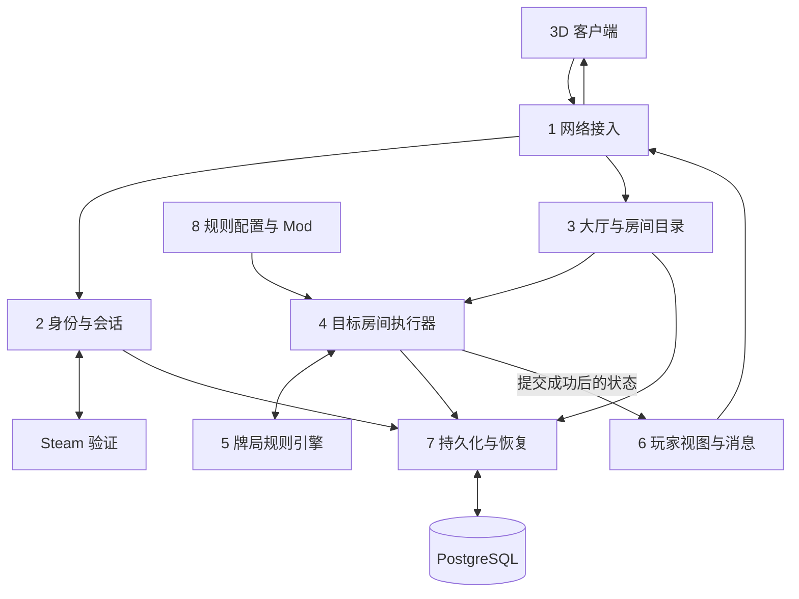

# 架构总览：连接、房间与牌局

本文按对象生命周期和数据流解释后端设计，补充[技术设计 v0.2](../technical-design.md)。它是设计说明，当前尚未实现网络、Steam 登录或数据库；已完成代码是牌、洗牌、抽牌、按参与名单发底牌、玩家视图、本地身份与座位绑定，进程内房间队列，以及内存中的命令去重与状态版本，详见[开发进度](../开发进度.md)。尚不包含持久提交与计时能力。

## 1. 先区分模块、进程和房间实例

下面划分的是 **8 个核心业务模块**。模块是一组职责，可以位于同一个后端程序中；不要求每个模块独立部署一个服务。它们对既有 Gateway、Domain、RoomRuntime、Contract、Persistence 等代码边界作进一步解释，不是额外叠加八个远程服务。

单机开发运行一个后端程序和 PostgreSQL。生产规划使用同一程序的多个实例、房间归属与接管机制；同一个房间在同一时刻只有一个有权提交状态的执行者。至少两个可接管的应用实例以及数据库故障恢复，仍需按既有设计实现和演练。

房间模块的代码只写一份，但运行时可以创建很多个房间执行器对象。每个对象管理自己的成员、整场、牌局和操作队列，使用同一套规则引擎代码。不同房间不共享可修改的牌局状态。

Steam 和 PostgreSQL 是外部依赖；3D 客户端是独立程序。机器人计算、运维监控属于辅助模块，离线 Python 研究也独立于以下主流程。

## 2. 四类数据各有自己的生命周期

| 对象 | 典型字段 | 存在多久 | 谁管理 |
| --- | --- | --- | --- |
| 玩家身份 | `player_id`、经过验证的 `steam_id` 映射 | 跨登录、跨房间保持稳定 | 身份模块 |
| 登录会话 | `session_id`、`player_id`、到期时间、撤销状态、凭据摘要 | 到期或撤销前有效，可跨短暂断线 | 身份与会话模块 |
| 网络连接 | `connection_id`、关联会话、连接对象、收发队列 | 从建立到断开 | 网络接入模块 |
| 房间成员 | `room_id`、`player_id`、座位／角色、准备状态、控制权代数 | 从被允许加入到被正式移出 | 对应房间的执行器 |

会话不要求包含房间 ID。已登录但没有加入房间时，登录会话有效、连接可用、房间成员记录不存在。这是一种正常状态。

连接可以缓存当前订阅房间等路由信息，但缓存不是成员资格证明。断开连接不会自动删除房间成员，也不等于弃牌、淘汰或主动离房。

连接对象和收发队列只在内存中。会话的凭据摘要、有效期等保存在持久存储；房间成员关系随房间状态保存。在线／离线的临时连接事实，不等于需要每次心跳写数据库。

### 索引如何定位

“表”可以指内存字典，也可以指数据库表，二者不能混用。计划使用以下索引：

| 索引 | 作用 | 权威性 |
| --- | --- | --- |
| `connection_id → ConnectionContext` | 定位某条连接及其已认证身份；收消息时通常已持有该上下文 | 只描述当前节点上的连接事实 |
| `player_id → 当前占座房间` | 登录或重连时找到可恢复的房间 | 可重建的查找索引，成员关系是依据 |
| `room_id → owner 节点` | 多实例部署时定位负责房间的服务节点 | 必须与持久房间归属核对 |
| 节点内 `room_id → RoomRuntime` | 直接定位当前房间执行器 | 内存注册表，按需加载，不能代替归属权限 |

首版建议一名玩家同时最多占用一个房间的座位；旁观订阅是另一种关系，未来可以另行扩展。占座约束需要持久化唯一性保证，不能只检查某个节点上的缓存。加入／移出成员时事务更新权威关系，成功后刷新索引；索引缺失可按玩家 ID 查询数据库索引恢复，不扫描所有房间。

网络连接可能已经绑定认证信息，因此每条游戏消息不需要再次请求 Steam。客户端可携带目标 `room_id` 用于路由，但真正的成员权限由房间检查，客户端不能指定可信的行动座位。

## 3. 八个核心模块及其输入输出

| 模块 | 从谁接收什么 | 负责什么 | 向谁提供什么 |
| --- | --- | --- | --- |
| 1. 网络接入 | 客户端的 HTTPS 请求、WSS 消息，以及连接建立／断开事件 | 协议解析、大小限制、连接上下文、收发队列 | 将票据交给身份模块；把经过认证的玩家身份、连接标识与请求交给目录／目标房间；把回执和玩家视图发回客户端 |
| 2. 身份与登录会话 | 接入层转交的 Steam 票据、访问令牌、重连凭据；Steam 验证响应 | 验证身份、创建／续期／撤销会话、提供稳定玩家 ID | 给接入层已验证身份或拒绝结果；经存储模块读写会话记录；不分配座位 |
| 3. 大厅与房间目录 | 已认证的建房、查询、加入、恢复房间请求；房间公开摘要 | 查找或创建房间执行器、定位 owner、提供公开房间列表 | 把加入／恢复请求转给目标房间；向接入层返回房间摘要或路由结果；不直接改成员与筹码 |
| 4. 房间执行器 | 已认证玩家命令、加入／离开／准备请求、控制权认领、内部超时事件 | 持有本房间成员与状态，以有界队列逐条检查权限、推进流程和提交 | 向规则引擎传递状态和命令；向存储模块提交候选变更；成功后把已提交状态交给视图模块并返回命令回执 |
| 5. 牌局规则引擎 | 房间执行器给出的冻结规则、当前状态、明确牌序／动作／座位 | 发牌、合法性、下注、改航、结算等确定性计算 | 向房间返回候选状态、领域事件和下一项等待条件，或拒绝理由；不直接写库或发送网络消息 |
| 6. 玩家视图与消息组装 | 房间给出的已提交状态、观看者身份对应的座位和权限 | 只选允许下发的字段，组装版本化消息 | 为每个接收者生成单独视图，通过网络模块发送；不把内部完整局面序列化给客户端 |
| 7. 持久化与恢复 | 房间的事务提交、加载请求，身份模块的会话读写，目录的索引查询 | 与 PostgreSQL 交互；保存快照、成员、事件、回执与归属；加载恢复材料 | 返回提交结果或已保存记录；房间根据恢复材料重建运行实例；不凭数据库表自行推断游戏动作 |
| 8. 规则配置与 Mod 管理 | 服务端批准的规则包，建房／开场时的配置与版本选择 | 校验允许的配置、生成不可变规则及摘要、保留恢复所需版本 | 向房间提供冻结的规则配置；向展示提供公开规则说明；不执行客户端上传的任意代码 |



图中是主要数据流，不表示每条消息都经过登录、建房或数据库加载。进入房间后，接入层可按已解析的路由直接向房间入队；身份检查使用有效会话，房间权限仍逐次校验。命令 ACK、错误和目录响应也通过网络模块返回，视图模块负责需要按接收者筛选的状态数据。

计时调度属于房间执行层：到期时产生一条内部消息入队，不由计时回调直接改牌局。房间空闲时异步等待消息，不为每房间永久占用一个线程，也不逐帧扫描所有房间。

## 4. 一个房间内部有什么

```text
房间 R7
├── 容量：8 个固定座位
├── 成员：玩家与座位／角色的绑定
├── 本局参与顺序：例如 [6, 0, 3]
├── 操作队列：加入、准备、下注、超时、重连认领……
├── 当前整场 M1：筹码、规则、已进行局数
│   └── 当前单局 H4：底牌、公共牌、下注、改航、结算
└── 服务状态：正常／故障恢复，当前归属及版本
```

“房间”“整场”“单局”有不同生命周期。一个房间可以先等待成员，再进行一场最多 12 局的比赛；整场结束后，房间可以保留，让原成员准备下一场。

容量、占座人数、本局参与人数也不同。成员占着座位，不代表这一局一定有牌；淘汰后保留座位编号，本局参与名单由规则和玩家状态确定。断线玩家的比赛资格和已持有的牌也不会因为 Socket 消失而改变。

房间执行器是状态提交入口。目录只能向它请求加入，规则引擎只能返回候选状态，数据库模块只负责保存；它们都不能在旁边直接改该房间的已提交内存状态。

## 5. 登录、开局和结束分别修改什么

以下假设玩家 P1 加入房间 R7、占内部座位 3：

| 事件 | 连接／登录会话 | 房间成员关系 | 房间／牌局状态 |
| --- | --- | --- | --- |
| 登录后留在主菜单 | 建立有效会话，可建立连接 C1 | 没有房间成员记录 | 没有该玩家的牌局 |
| 加入 R7 | 继续使用同一身份；可以开始订阅 R7 | 新建 `R7 + P1 → 座位3`，持久保存 | 更新房间成员与版本，可能仍在准备 |
| 开始一整场 | 不需要更换会话或连接 | 保留座位绑定 | 创建 M1，冻结规则，初始化筹码与第一局，持久提交 |
| 第一局结束、第二局开始 | 不变 | 保留座位绑定 | 更新 M1 中的局数、筹码、淘汰结果和当前单局 |
| 个人断线 | C1 关闭；登录会话按有效期保留 | 保留占座关系和牌局资格；更新临时连接事实 | 健康服务器继续按原行动期限处理 |
| 重新连接 | 创建 C2，恢复或重新验证同一玩家身份 | 原房间确认成员仍有效，更新控制权代数与控制连接 | 保留当前进度，下发新连接的当前视图 |
| 整场结束 | 会话与连接仍可用 | 成员仍可留在房间 | M1 完成，房间进入结果／等待下一场的流程 |
| 被允许正式离房 | 登录会话仍可用 | 由房间释放占座关系，更新查找索引 | 根据规则更新房间；不能直接删除仍需结算的筹码与状态 |
| 注销或会话失效 | 撤销会话并终止相应访问 | 进行中的房间仍按断线／离房规则处理 | 不能把注销当成清空牌局的指令 |

所以开局、结算确实需要更新并保存状态，但不会因此反复创建／删除登录会话。房间 ID 在加入／正式离开时影响成员关系，不随每一局开始和结束变来变去。

保存也不限于开局和结算。每个被接受的、改变权威状态的动作都按既有事务设计提交；只在始末保存会丢失中途进度。纯查询、普通心跳和临时连接在线状态，不按下注动作的方式创建牌局提交。

## 6. 掉线重连的完整路径

1. 网络接入层发现 C1 断开，停止使用这条连接。房间中的 P1、座位 3、底牌、筹码继续存在。
2. 客户端建立 C2，用有效令牌／轮换凭据，或新的 Steam 票据重新验证。无论登录会话是否更换，稳定玩家 ID 仍为 P1。
3. 目录按 P1 的成员索引找到 R7，再定位当前 owner。客户端保存的房间 ID 只能用于定位，服务器要核对实际成员关系。
4. 房间将恢复／认领请求排队，验证 P1 仍是成员。成功后提高控制权代数，允许 C2 操作，旧控制连接失去提交新动作的权限。
5. 若客户端有“发出后未收到结果”的命令，用原命令 ID 查询回执；已经成功的动作不重复扣款。
6. 房间在同一顺序处理点建立订阅并排入当前完整玩家视图，之后再发送后续更新。视图使用新流标识和当前状态版本，避免旧消息覆盖新状态。

这个过程不重新洗牌、不重置筹码，也不延长原行动期限。个人断线不暂停全桌；到期由房间提交规则允许的默认动作，例如可免费过牌时过牌、面对下注时弃牌、改航时放弃。

若重连时已经结算，就发送当前结算结果；若成员资格已释放或房间已关闭，就返回相应状态，不恢复已不存在的席位。若是服务节点故障，备用节点从已提交快照和记录恢复房间，按服务故障补时规则处理，和个人断线分开。

## 7. 一次加注如何流过模块

```text
客户端：发送加注意图、金额、命令 ID、预期版本、行动机会 ID
  ↓
网络接入：解析消息，附上已验证的玩家身份与连接上下文
  ↓
目录／路由：按 room_id 定位目标房间执行器
  ↓
房间：检查房间访问、原回执、当前控制权、版本和行动机会
  ↓
规则引擎：检查合法金额，返回候选筹码状态及事件
  ↓
持久化：原子保存新状态、事件、回执并检查当前房间归属
  ↓ 提交成功
房间：替换当前内存状态，返回命令成功回执
  ↓
视图模块：为各玩家分别构造允许看到的状态
  ↓
网络接入：通过各自的发送队列发给对应连接
```

同一房间的动作逐个处理，不同房间可以并行。慢连接不会阻塞房间提交，网络发送不在数据库事务里等待。

数据库明确回滚时保持原状态；提交结果未知时先冻结后续写入、查回执和权威状态。不能假设失败后直接再扣一次款，也不能在保存成功前向玩家宣布动作成功。

## 8. 下一步实现顺序

已实现使用稳定玩家 ID 的本地房间：容量与成员绑定、发牌前入座／离座边界和按身份获取视图；外层是单房间有界队列，允许并发提交并逐条处理。底层房间仍要求顺序调用，执行器内部独占它；发牌后锁定成员绑定。修改以命令对象提交，按命令编号在内存中去重并检查预期版本。后续需接入正式状态推进、持久回执及网络认证，尚不支持整场结束、网络重连或跨房间唯一占座。

当前源码中的 `生成玩家视图(座位)` 是可信内部接口。后续外层接口接受“已验证身份”，在房间里查出座位后才能调用它。把一个客户端自报的用户 ID 当作测试身份的方法只能留在测试边界，不能成为正式登录接口。
