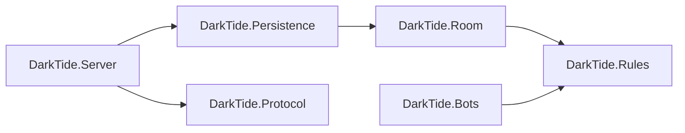
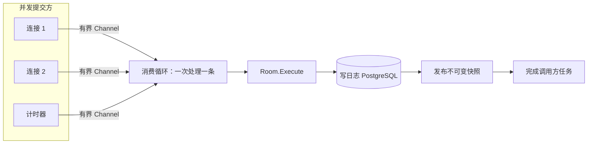

# 暗潮航线：开发交接文档

截至 2026-10-23（加入本文的那次提交）。这份文档写给接手开发的人：读完应能知道系统现在是什么样、为什么这样设计、哪些约定不能破坏、还缺什么、缺的部分打算怎么做、做到什么程度算完成。

和其他文档的关系：

| 文档 | 用途 | 状态 |
| --- | --- | --- |
| 本文 | 交接总览：现状、设计、待办、验收 | 2026-10-23 |
| [开发进度](开发进度.md) | 逐模块的实现细节、配置表、实测数字；**每次改动都要更新** | 当前 |
| [标准牌局规则 v1.0](standard-rules.md) | 玩法的唯一依据 | 2026-10-09 确认，2026-10-16 补充“改航只换第二张” |
| [技术设计 v0.2](technical-design.md) 及 `technical/` 下各篇 | 编码前写的目标设计 | 部分已过时，差异见第 9 节 |

代码与本文冲突时以代码和测试为准，并修正本文。

---

## 1. 一页看懂

**产品**：一个三花色、27 张牌的下注卡牌游戏。玩家可以花钱“改航”，替换所有人共享的第二张公共牌。目标是独立 3D 客户端，多人在线，在 Steam 发行。

**现状**：C# 权威服务器已经可以完整打一场：游客身份 → WebSocket 连接 → 建房、入座 → 房主开始 → 12 局下注与改航 → 结算 → 整场结束。每一步操作在确认给玩家之前都已写入 PostgreSQL，进程崩溃后可以从日志恢复。还没有客户端，没有部署环境，没有 CI。

**质量**：522 个 C# 测试与 103 个 Python 测试全部通过，Release 构建 0 警告（警告即错误）。端到端压测在单机 5000 个 WebSocket 连接、1000 张牌桌下没有错误，动作确认 p99 约 230 ms。

**上线前必须补上的**：两个代码缺陷（第 7.1 节：只建房不开局的房间永远不会被清理，会耗尽房主的建房名额；建房请求不幂等，重试会多建房间），以及部署层的 TLS 终止和反向代理配置（第 7.2 节）。
**用户已决定暂缓的**：多实例部署（2026-10-23）。

---

## 2. 用户（项目负责人）的工作方式

这些是用户明确提出、并多次重申的要求。接手后请继续遵守。

1. **工程第一，只做能上线的代码。** 每一步完成前都要按三条审查：安全（每个入口都有授权检查、不泄露隐藏牌、随机数用安全随机源、不可信输入有上限）、负载（热路径上的分配、房间循环里做了什么、扇出成本、任何无上限的增长）、可运维（会不会永远卡住、生命周期清理、配置校验、指标与日志不含机密）。用测量代替假设。剩下的缺口如实报告，不要写成“以后再说”。
2. **小步前进，每步验证。** 每个子步骤都要构建并跑测试，通过后才做下一步。
3. **讲解放在对话里，不放进仓库。** 2026-10-13 用户删掉了逐步教学文档和示例程序。仓库只保留恰当的代码注释和 `docs/开发进度.md`（本交接文档是用户要求的例外）。每步结束时提几个理解问题，**答案紧跟在问题后面**。用户说过：项目做完了，但自己没真正理解，也算失败。
4. **对局结果将与排名、奖励甚至付费挂钩（2026-10-15）。** 崩溃丢掉进行中的对局不可接受，所以每条命令写入数据库后才确认。不要为了性能提议去掉逐条持久化、改用内存加对局结束归档，或关闭同步落盘。
5. **部署前先排空房间。** 用户的思路是不让未完成的房间跨越代码版本；`RulesVersion` 只是兜底。
6. **人机的约束**见第 6 节，属于用户的设计决定，不要擅自加入对手建模。

---

## 3. 仓库地图

```
README.md                项目与规则研究总览（Python 实验的复现命令在这里）
global.json              固定 .NET SDK 10.0.100（latestFeature 前滚）
docs/
  交接文档.md             本文
  开发进度.md             C# 实现细节，随改动更新
  standard-rules.md       标准规则 v1.0（唯一玩法依据）
  technical-design.md     技术设计 v0.2 入口；technical/ 下为分篇
  archive/                网页方向的 v0.1 设计，已废弃
  （其余为历史规则草案与实验说明）
reports/                 Python 实验的报告与原始数据（约 130 万行 CSV/JSON，只读）
simulation/              Python 规则参考实现与平衡实验（仅标准库，3.10+）
tests/                   Python 测试（unittest，103 个）
server/
  DarkTide.slnx           解决方案
  Directory.Build.props   net10.0、Nullable、警告即错误
  protocol/darktide_v1.proto   客户端协议（唯一事实来源）
  src/
    DarkTide.Rules/       纯规则：牌、牌型、单局、下注轮、改航、奖池、整场。零依赖
    DarkTide.Room/        房间：座位、阶段、命令、去重、单线程执行器、计时、日志抽象、发布快照
    DarkTide.Persistence/ PostgreSQL：命令日志、凭据存储、迁移脚本
    DarkTide.Protocol/    由 .proto 生成的 C# 消息（客户端适配层可以只引用它）
    DarkTide.Bots/        人机：胜率表、门槛人机、自我对战平台
    DarkTide.Server/      ASP.NET Core 宿主：会话、实时连接、房间目录、健康检查、指标
  tests/                  每个 src 项目一个 xUnit 测试项目
  tools/
    DarkTide.Benchmarks/  持久化与对局负载（需要 PostgreSQL）
    DarkTide.LoadTest/    端到端 WebSocket 压测客户端
    DarkTide.SelfPlay/    人机自我对战与调参
    DarkTide.EquityTables/ 重新生成胜率表
```

依赖方向是单向的：



规则层不知道房间、网络和存储；房间层只依赖 `IRoomJournal` 抽象，不知道 PostgreSQL；人机只依赖规则层，目前没有接进服务器（第 8.1 节）。

代码量（不含生成代码）：规则 1936 行、房间 2722 行、服务器 2723 行、人机 1250 行、持久化 618 行；测试约 8700 行。

---

## 4. 构建、测试、运行

需要 .NET 10 SDK；持久化测试和压测需要 Docker（Testcontainers 会自动拉起 PostgreSQL 17）。

```bash
dotnet build server/DarkTide.slnx -c Release          # 0 警告才算通过
dotnet test  server/DarkTide.slnx -c Release          # 522 个，约 2～3 分钟
python3 -m unittest discover -s tests                 # 103 个，规则参考实现
```

本地运行（内存模式，不持久化）：

```bash
export Session__Keys__0__Id=dev
export Session__Keys__0__Secret=$(head -c 32 /dev/urandom | base64)
dotnet run --project server/src/DarkTide.Server
```

没有签名密钥时进程以退出码 78 拒绝启动，这是有意的。

连接数据库运行（生产形态）：

```bash
# 1. 部署步骤：用表所有者账号迁移并给运行账号授权，然后退出
ConnectionStrings__DarkTideMigrations="Host=...;Username=darktide_owner;..." \
ConnectionStrings__DarkTide="Host=...;Username=darktide_app;..." \
  dotnet DarkTide.Server.dll --migrate

# 2. 服务只持有运行账号
ConnectionStrings__DarkTide="Host=...;Username=darktide_app;Maximum Pool Size=180" \
Session__Keys__0__Id=k1 Session__Keys__0__Secret=... \
ASPNETCORE_URLS=http://0.0.0.0:8080 dotnet DarkTide.Server.dll
```

数据库管理员需要事先建好两个角色，并给运行账号 `USAGE ON SCHEMA public`（PostgreSQL 15 起普通账号默认没有）。具体做法见 `server/tests/DarkTide.Persistence.Tests/LeastPrivilegeTests.cs` 开头。

退出码：0 正常；78 配置错误或数据库结构过旧（重启也不会好，编排器不要无限重启）；1 其他启动失败（通常是数据库连不上，可以重启重试）。

---

## 5. 已完成的系统

### 5.1 规则核心（`DarkTide.Rules`）

实现了标准规则 v1.0 的全部玩法：27 张牌（红蓝绿 × 1～9），每人两张底牌，三张公共牌；牌型为三条 > 同花顺 > 顺子 > 同花 > 对子 > 散牌，从九种合法组合（至少用一张底牌）中取最强；三轮下注，采用底池限注，有加价权、最小开注与最小完整加价、短额全下；每轮关闭时退还没有被跟上的超额；按累计投入切出主池与边池；改航只换第二张公共牌，名单按下注顺序反向，费率 5%→10%，向上取整且最低一份底注，报价在窗口开始时冻结，费用进入独立的附加池；摊牌分池，余数从起始位依次补一枚；12 局整场，前六局底注 1、后六局底注 2，筹码为零才淘汰。

关键设计：

- **筹码只记“每个座位的累计普通投入”这一个数组**，主池、边池、连环全下都由它推导（`PotLayering.SplitRegularPots`，纯函数）。任何地方都不单独保存“池总额”。
- **`Chips` 是值类型**，从类型上保证不为负；扣成负数直接抛异常，说明账算错了。
- **洗牌用 `RandomNumberGenerator` 做 Fisher–Yates**，不用 `System.Random`。牌序写进发牌命令，重放时不重新洗牌。
- **随机整局性质测试**（`HandPropertyTests`）：3000 局随机合法走法，检查筹码守恒（含改航费）、不出负数、弃牌者不得池、每个多人池的赢家牌力最大。下注规则里的三个缺陷是靠它发现的，都已有回归用例。

### 5.2 房间（`DarkTide.Room`）

一个房间 = `Room`（状态）+ `RoomExecutor`（单线程执行器）。



- **一个房间一个消费循环**，所有修改都排队串行执行，规则代码不需要锁。命令与查询的排队额度分开（56／8），满了立即返回“忙”，不无限排队。
- **修改只能通过命令对象**（`TakeSeat`、`LeaveSeat`、`Deal`、`Bet`、`Reroute`、`Timeout`）。命令是数据：可以比较、去重、写日志、重放。
- **处理顺序固定**：先查是否处理过这个命令编号，再查预期版本，最后执行规则。先查原结果是因为：命令成功后版本已经前进，重发如果先比版本，会把成功误报为“版本不符”。
- **每玩家流量控制**：同一玩家同时只能有一个未完成的命令；没等到结果就重发同一命令，会合并到同一个结果；令牌桶限速（突发 10，每秒 5）。
- **计时**：行动超时（默认 30 秒），能过牌就过牌，否则弃牌；改航超时视为放弃；结算后间隔 5 秒自动发下一局。超时本身也是一条写进日志的命令，裁决按谁先进入房间队列，重放时不看时钟。
- **发布快照**：每次状态变化后，消费循环生成一份不可变的 `PublishedRoomState`（实测 1.4 µs、约 2.6 KB），并且在完成命令结果**之前**发布。所以调用方拿到“已提交，版本 N”时，已发布的状态一定不早于 N。连接读这份快照，不进房间队列。
- **有界关闭**：在时限内排空，超时就放弃仍在排队的请求（调用方可以安全重试），正在执行的那一条照常做完。
- **业务拒绝与故障分开**：规则拒绝（`RuleRejectedException`）保证抛出前没改任何状态，房间继续运行；其他任何异常都视为状态可疑，停止该房间。

### 5.3 持久化（`DarkTide.Persistence`）

持久化方式是**命令日志 + 重放，没有状态快照**。

- 每条命令的最终结果（成功带版本号，或拒绝带原因）写入 `room_commands` 之后，才完成调用方的任务。写入超时（5 秒）时结果未知：房间停止，调用方收到 `RoomPersistenceException`，之后用同一个命令编号重试是安全的。
- 重启时按序号重放全部命令重建房间，并**逐条核对**结果与日志一致，不一致就拒绝加载。
- 每个房间建房时记下 `rules_version`，恢复前先核对；当前代码不能重放的房间会跳过并保持未关闭，启动时记一条 Critical 汇总。
- 数据库闪断时，房间按退避策略（1 秒起、翻倍、最长 60 秒）在进程内自动重建；10 分钟内故障超过 5 次就停下等人工处理。
- **最小权限**：运行账号只能对日志执行 INSERT 和 SELECT。触发器再挡一层，连表所有者也不能 UPDATE、DELETE 或 TRUNCATE 日志。房主、规则版本、凭据归属写入后都不能修改，有权限测试覆盖。

| 表 | 内容 | 迁移 |
| --- | --- | --- |
| `rooms` | 房间编号、座位数、创建时间、关闭时间、规则版本、房主 | 001、003、005 |
| `room_commands` | (房间, 序号) 主键；命令编号唯一；版本化 JSON 载荷；结果二选一 | 001、002 |
| `players` | 游客玩家编号（UUIDv7）、类型、封禁时间 | 004 |
| `player_credentials` | 重连凭据的 SHA-256、归属、有效期、轮换链、吊销 | 004 |
| `schema_migrations` | 已应用的迁移 | 001 |

### 5.4 游客会话（`DarkTide.Server`）

暂不做账号系统，由服务端签发游客身份。以后接 Steam 只是多一种换取会话的方式，玩家编号和凭据机制不变。

| 凭据 | 形式 | 有效期 | 校验 |
| --- | --- | --- | --- |
| 访问令牌 | `v1.` + 载荷 + HMAC-SHA256；放在 `Authorization: Bearer` 头 | 10 分钟 | 只验签名和过期时间，不查库（3 µs/次） |
| 重连凭据 | `r1.` + 32 字节安全随机数 | 24 小时 | 数据库只存 SHA-256；每次使用都轮换 |

- `POST /sessions/guest` 创建身份，`POST /sessions/refresh` 换新，`GET /sessions/me` 自检。响应带 `Cache-Control: no-store`。
- **盗用检测**：新凭据由旧凭据经 HMAC 确定性推导，丢了响应后重试得到同一张。已经换过的旧凭据在 60 秒宽限期外，或者新凭据已经被用过之后再出现，就判定为被盗，吊销该玩家的全部凭据。
- **换密钥**：新密钥放在第 0 位，旧的移到后面只做验证，10 分钟后删除。每把密钥各自推导候选后继，换密钥前后的重试不会被误判为盗用。
- **防滥用**：每地址每分钟创建 10 个、换新 30 次（IPv6 按 /64 归并）；全进程每秒最多创建 50 个；会话相关的数据库操作最多同时 16 个，超出立即 503，不挤占对局写入。所有 HTTP 请求体上限 16 KiB。

### 5.5 实时连接（`DarkTide.Server/Realtime`）

`GET /realtime` 升级为 WebSocket，子协议 `darktide.v1`。握手时校验访问令牌，令牌只从 `Authorization` 头读，不读 URL。协议见 `server/protocol/darktide_v1.proto`，一个二进制消息是一条 Protobuf。

- **请求**：建房、加入（订阅）、入座、离座、开始整场（仅房主，带预期版本）、下注、改航、ping。玩家编号只取自认证身份，消息里没有任何字段能指定别人。未知或 `UNSPECIFIED` 的枚举一律返回 `INVALID`，不会被当成默认的过牌或跟注。
- **推送**：每次状态变化推送一份完整快照（不是增量），平均约 150 字节。按接收者投影：底牌只发给本人，合法动作只发给轮到的人，别人的底牌只在摊牌结算里出现。没有推送队列，慢客户端直接跳到最新版本。
- **控制权**：同一玩家最多 2 个连接，只有最新的能操作，旧的只读；第 3 个连接会取代最旧的。
- **连接寿命**：访问令牌到期时服务端断开连接（`TOKEN_EXPIRED`），否则封禁永远不生效。每 15 秒发 ping，同样时间内没有回应就断开。

| 资源 | 默认上限 | 超出时 |
| --- | --- | --- |
| 单条消息 | 1 KiB（按整条，不按分片） | 关闭连接 |
| 每连接消息速率 | 20/秒 | 回复 `BUSY` 与退避时间；超过 60/秒关闭连接 |
| 单次发送 | 10 秒 | 按太慢关闭 |
| 连接总数 | 20000 | 拒绝 |
| 每人未结束的房间 | 3 | `FORBIDDEN` |
| 建房速率 | 全进程 20/秒 | `BUSY` |
| 房间总数 | 10000 | `UNAVAILABLE` |

### 5.6 可观测性与运维

- **日志**：生产环境每行一条 JSON。**日志和指标绝不输出牌面**，`DealCommand`、`PlayerHandView`、`ViewerSnapshot` 都覆盖了 `ToString()` 做脱敏，有测试断言。
- **指标**（OTLP，设置 `OTEL_EXPORTER_OTLP_ENDPOINT` 后启用）：Meter `DarkTide.Room` 有 `darktide.room.requests`、`.request.duration`、`.submissions.rejected`、`.requests.abandoned`、`.faults`；Meter `DarkTide.Server` 有 `darktide.rooms.*`（active、waiting_commands、recoveries、recovering、restore_failures、finished_closures）、`darktide.sessions`、`darktide.realtime.*`（connections、closed、states_pushed、bytes_sent、rooms_created、rejected_connections、throttled）。**标签里不放房间编号或玩家编号**，避免高基数。
- **健康检查**：`/health/live` 只要进程活着就返回 200；`/health/ready` 在关闭中或数据库不可达时返回 503。两者都不需要认证，部署时只应在内网可达。
- **关闭**：SIGTERM 后 Kestrel 先停止接收，所有房间并行排空，各自受 `Room:ShutdownTimeout`（10 秒）限制。

### 5.7 性能（实测，16 核 WSL2，Docker 中的 PostgreSQL 17，同步落盘）

| 场景 | 结果 |
| --- | --- |
| 房间内一条命令 | 5.7 µs、780 字节分配 |
| 发布一份快照（5 人局） | 1.4 µs、2.6 KB；按观看者取视图 13 ns |
| 对局负载（2000 房间，思考 1 秒，连接池 180） | 1844 动作/秒，p50 46 ms，p99 185 ms |
| 端到端（5000 个 WebSocket，1000 桌） | 313 动作/秒，p50 48 ms，p99 230 ms，峰值内存 439 MiB，无错误、无掉线 |
| 启动恢复 1000 房间 × 360 条命令 | 约 1 秒 |

**瓶颈是数据库落盘（fsync），不是代码**：本机单次提交约 33 ms。生产换带掉电保护缓存的 SSD 会下降一个数量级以上。第二个瓶颈是连接池：连接串里没写 `Maximum Pool Size` 时代码默认 50（`ServerDefaults.DatabaseMaxPoolSize`），上面的压测显式设了 180，比 100 时延迟减半。生产按负载显式设置，并给数据库的 `max_connections` 留出余量（PostgreSQL 默认 100）。

CPU 这次没有测准，下次用 `dotnet-counters`。

---

## 6. 人机（`DarkTide.Bots`）

用户的设计决定（2026-10-16 至 10-20），**不要擅自改变**：

1. **只用牌面信息**：自己的底牌、公共牌、被改航换掉而公开的牌。不从对手的下注或改航推断任何东西。
2. **只算自己的胜率**：假设对手底牌随机，查预计算的胜率表。不猜对手的手牌范围。
3. **改航只为自己决定**：比较换与不换的平均胜率，提升超过“费用 ÷ 可争夺池 + 余量 0.02”就换。
4. **弃牌看门槛**：面对下注时，胜率低于本轮门槛就弃。门槛按轮次和对手人数分别设置，基准由自我对战实验得出。
5. **按结果动态调整**：弃了但本该是最大（只在三张公共牌全开的真实摊牌时判断）→ 下一局门槛降一点；打到底却输了 → 升一点；其他情况不变。下调步长 ÷ 上调步长 = 7.12，这个比例让基准成为平衡点。
6. **性格**：每个人机的上调步长在 0.002～0.012 之间随机取一次（由性格种子决定），偏移上限 ±0.10。实测性格不会让人机变弱。

胜率表覆盖已知 2～5 张牌 × 1～7 名对手，单挑精确枚举、多人抽样，约 2 MB，嵌入程序，运行时只查表；牌型规则一改，加载旧表会直接报错，必须重新生成（16 核约 75 秒）。门槛基准由自我对战调出（16 核约 38 分钟），具体数值见开发进度。

限制：只在 5 人桌、这一种对手组合下调过参；5～7 名对手的门槛是按倍数外推的；2 人桌的整场没有单独调。

**人机还没有接进服务器**，目前只在 `SelfPlayArena` 里使用。接入方案见第 8.1 节。

---

## 7. 已知问题与限制

### 7.1 交接时发现的缺陷（未修）

写本文时复查代码发现了两个缺陷，都还没有修。我认为它们属于“上线前必须修”。

**缺陷 1：只建房、没开局的房间永远不会被关闭。**

- 原因：`RoomDirectory.CloseWhenFinishedAsync` 只在整场结束后关闭房间；协议也没有“关闭房间”或“解散”的请求。
- 后果 1：房间在数据库里一直保持未关闭，每次重启都会重新恢复，所以内存、启动时间和 `MaxRooms` 名额都会随这类房间累积。
- 后果 2：每人未结束房间上限（3 个）把还没开局的房间也算进去，所以玩家建了 3 个房间却没打，**这个身份就再也建不了房**。
- 修法建议：给 `RoomOptions` 加 `UnstartedRoomRetention`（例如 30 分钟），在 `WaitingForSeats` 阶段超时且没人入座就关闭；再给协议加一个仅房主可用的 `CloseRoom`。注意关闭也要写日志，并且和恢复流程兼容。
- 验收：建房后不入座，超时后房间关闭、日志里 `closed_at` 有值、重启后不再恢复、房主名额释放。

**缺陷 2：建房请求不是幂等的。**

- 原因：`CreateRoom` 没有命令编号，服务端每次都生成新的房间编号。
- 后果：客户端没收到建房响应就重试，会多建一个房间；结合缺陷 1，三次重试就会耗尽名额。
- 修法建议：协议的 `CreateRoom` 加 `command_id`，在目录里按（房主，命令编号）去重，并持久化，例如在 `rooms` 表加一个唯一键。
- 验收：同一命令编号重发得到同一个房间编号；不同编号才建新房。

### 7.2 上线前必须解决（部署层）

- **TLS**：服务器本身只开 HTTP。生产必须部署在终止 TLS 的反向代理后面（`wss://`），否则访问令牌会明文传输。
- **反向代理配置**：必须设置 `ForwardedHeaders:KnownProxies`，否则所有请求都算作代理一个地址，按地址限流会误伤所有玩家。没配置时服务器不读转发头，这是有意的，防止伪造。
- **健康端点**：只在内网或管理端口可达。
- **数据库账号**：生产环境的服务进程只持有运行账号；运行账号是超级用户时启动会警告。

### 7.3 已知但暂时可以接受

- 访问令牌吊销不即时：只验签不查库，被盗的令牌最多还能用 10 分钟（重连凭据的吊销是即时的）。
- 已关闭房间的日志和回执没有清理，保留期尚未定义。
- 牌序以明文 JSON 存在 `room_commands.payload`，数据库访问和备份要按受限数据管理；还没做字段加密。
- 重放时间随命令数线性增长。一场约 300 条命令，可以接受。
- 游客身份行不清理，因为玩家编号要和对局记录长期对应；全局创建速率把增长封顶（最坏每天约 430 万行）。
- 行动时限 30 秒、局间 5 秒、结束后保留 5 分钟，以及各项限流额度都是初值，没有经过真人测试。
- 控制权代数（哪个连接能操作）只在本进程内；多实例时需要持久化。
- 建房时统计房主的未结束房间数要遍历全部房间：1 万房间实测约 300 µs、80 KB 分配，在建房锁里执行。建房速率默认 20/秒，最坏约占一核的 0.6%；房间数或建房速率上一个数量级时，改为按房主维护计数。
- 协议没有做“未知字段拒绝”：Protobuf 默认忽略未知字段。目前所有字段的语义都不依赖未知字段，风险低；设计文档要求游戏命令拒绝未知字段，接客户端时再定。

### 7.4 待规则作者确认

1. **规则 4.3 的例子与定义不一致**：按“P 包含本轮正在等待响应的下注”算，“行动前池 20、需跟 6”应得 38，例子写的是 32。代码按例子（32）实现，见测试 `BettingRoundTests.PotLimitCapsAtPotPlusTwiceCall`。
2. **规则 4.3 的“独得池”有两种理解**：参考实现的理解在实际局面中从不改变结果（逐决策点比较 201208 次，无差异）；更严格的理解（“除唯一有资格者外，没人还能够到这一层”）会在其中 16 次让最高加注额变小。目前按参考实现。
3. **Python 模拟仍允许改航换第一或第二张**，而标准规则已确定只换第二张（2026-10-16）。`simulation/` 里与改航有关的实验结论不能直接沿用。

---

## 8. 待做的设计与预期方案

按我建议的顺序排列。第 0 项是第 7.1 节的两个缺陷。

### 8.0 修复缺陷（第 7.1 节）

工作量小，影响上线，建议最先做。

### 8.1 人机补位

**目标**：玩家不够时，人机坐进房间，和真人走完全相同的规则路径。

**方案**：

- 人机是一种“受信任的本地客户端”：它有自己的玩家编号，经 `RoomExecutor.ExecuteAsync` 提交和真人一样的 `BetCommand`、`RerouteCommand`，因此日志、重放、去重、超时都不用改。**不要给人机开后门命令。**
- 观察来自 `PublishedRoomState.ViewFor(botId)`，再转换成 `BotObservation`。转换逻辑参照 `SelfPlayArena.Observe`：底池要包含本轮已投入的筹码，对手数是未弃牌的人数。这样人机在类型上就拿不到别人的底牌。
- 计算放在受限的工作线程上，**不能在房间消费循环里算**。人机思考期间房间要能继续处理其他请求。下注决定只查表；改航决定实测约 0.74 ms（有死牌时要重算单挑胜率），是房间内一条命令的 100 倍以上，放进循环会直接拖慢整桌。
- 每个人机有思考时间上限，超时就交给房间的正常超时处理，不能让人机拖住整桌。
- 加人机的权限：谁能加（房主？）、加在哪个座位、什么阶段能加，需要用户决定。
- 人机的性格种子要写进日志或房间配置，否则恢复后性格会变。人机的动态门槛状态（结果偏移）也要能从日志重建：要么把每局结果重放给人机，要么把偏移量随命令记录。**这一点必须在动手前设计清楚。**

**验收**：

- 1 真人 + 4 人机能打完整场；所有人机的命令都出现在日志里，重放结果一致。
- 进程重启后人机继续行动，性格和门槛偏移与重启前一致。
- 人机计算期间，同房间的真人查询和其他房间的延迟不受影响（压测对比有无人机时的 p99）。
- 人机的观察里没有别人的底牌（类型保证，外加测试）。

### 8.2 客户端适配层

**目标**：3D 客户端（Unity、Unreal 或其他引擎）通过 `darktide_v1.proto` 接入。

**方案**：

- 客户端用 `protoc` 从 `server/protocol/darktide_v1.proto` 生成代码。不要手写编解码，也不要把服务端的 C# 程序集直接放进 Unity（`net10.0` 与 IL2CPP 的兼容性没有验证过）。
- 客户端的状态模型就是“最新的 `RoomState`”：收到新的就整体替换。动画可以落后或直接跳到最新状态，但不能等动画播完才允许操作。
- 必须实现的客户端行为：
  1. 命令编号在同一次用户意图的重试中保持不变，收到确定的拒绝后才换新编号。
  2. 收到 `BUSY` 时按 `retry_after_ms` 退避，并用同一个编号重试。
  3. 访问令牌过期前主动刷新；收到 `TOKEN_EXPIRED` 后换新令牌再重连。
  4. 断线重连后重新 `JoinRoom`，用推送来的快照恢复画面。
  5. 用 `server_time_unix_ms` 校正本地时钟，再画倒计时。
- 加注控件要分清“本轮累计目标额”（协议里的 `raise_target`）和“本次新增投入”。短额全下不能被算成完整加价。

**验收**：设计文档 `technical/prototype-and-validation.md` 第 3 节列出的联调场景全部通过；用客户端打完一场，并演练中途断网重连、令牌过期、重复点击。

### 8.3 Steam 身份

**目标**：用 Steam 票据换取会话，与游客身份并存。

**方案**：

- 新增 `POST /sessions/steam`：客户端提交 Steam 会话票据，服务端调用 Steam Web API 验证，再按 SteamID 查找或创建玩家（`players.kind` 加 `'steam'`，另加 SteamID 唯一列，用 `numeric(20,0)` 存，不能塞进有符号 bigint），然后签发同样的访问令牌和重连凭据。
- Steam publisher key 只放在后端的密钥管理里，绝不进客户端、Mod 或协议消息。
- Steam 不可用时新登录明确失败，**不能退化成相信客户端自报的 SteamID**。
- 游客转 Steam 账号的合并策略需要用户决定。

**验收**：伪造票据、过期票据、他人票据、重复使用票据都被拒绝；同一 SteamID 多次登录得到同一个玩家编号。

### 8.4 多实例部署（用户已决定暂缓，2026-10-23）

**为什么暂缓**：单机实测 5000 连接只用了 439 MiB 内存，一台机器应该能扛住几万连接；单实例的代价是宕机或更新时中断几秒到几十秒，对局本身不会丢（从日志恢复）。等玩家规模上来再做。

**问题本身**：所有进程共用一个数据库。两个进程如果都把同一个房间加载进内存，就会各自接受操作，让同一局分叉。现在的序号主键只能让后写的那个进程失败，挡不住两边都给玩家推送画面。

**预期方案**（设计文档 `protocol-and-concurrency.md` 第 7 节）：

- 新表 `room_ownership(room_id, owner_id, owner_epoch, lease_until)`。进程取得或续约租约时，在同一个原子操作里提高 `owner_epoch`。
- 每次追加日志都在同一事务里校验 `owner_epoch` 和租约有效期，旧的拥有者写不进去（围栏）。
- 租约过期后，其他进程才能接管：重新加载日志，用新的 epoch 继续。
- 连接路由：玩家要连到拥有该房间的进程，或者由网关转发。路由方案（一致性哈希、目录服务、Redis 等）需要另外设计。
- 控制权代数（第 5.5 节）随房间所有权一起持久化。

**验收**：两个进程竞争同一个房间时，任何时刻只有一个能提交；模拟网络分区和租约续约失败，没有重复派奖、没有分叉；单节点故障后，房间在 30 秒内由另一节点接管。

### 8.5 其他尚未开始的部分

| 项目 | 现状 | 备注 |
| --- | --- | --- |
| CI | 无 | 至少要跑构建、C# 测试（需要 Docker）、Python 测试 |
| 部署脚本与容器镜像 | 无 | 迁移要作为单独的部署步骤（`--migrate`） |
| 已关闭房间的数据保留与清理 | 未定义 | 与排名、奖励的审计需求一起定 |
| 排名、奖励、付费 | 未开始 | 用户已确定结果会挂钩，持久化设计已按此做 |
| Mod（参数规则包） | 只有设计 | `technical/mods-and-security.md` |
| 对局回放或审计查看 | 未开始 | 日志已足够重建任意时刻的状态 |
| 牌序字段加密 | 未做 | 第 7.3 节 |

---

## 9. 实现与设计文档 v0.2 的差异

设计文档是编码前写的。下面这些地方，实现有意选择了不同做法，或者还没做到。改代码前要清楚哪份说法有效。

| 设计文档说的 | 实际实现 | 原因 |
| --- | --- | --- |
| 状态快照 + 事件 + 回执，同一事务提交 | 只有命令日志，靠重放重建，没有快照 | 一场只有约 300 条命令，重放约 1 ms；快照会多出一份要保持一致的数据。用户撤回了快照方案，改为部署前排空 |
| 回执唯一键 (room_id, principal_id, command_id) | 唯一键 (room_id, command_id)，命令内容里含玩家编号 | 别人无法冒充你的命令；最坏只能抢占你的编号，而编号是随机 UUID |
| `turn_id`、`controller_epoch`、`owner_epoch` | 用 `expected_version`（每次状态变化加一）代替 `turn_id`；控制权代数只在内存；没有 `owner_epoch` | 单实例下够用；多实例时要补上 |
| 服务故障时冻结剩余行动时间，恢复后补回 | 恢复后计时重新开始（给满一个完整时限） | 实现简单，玩家不吃亏；代价是故障可能多给一点时间 |
| 访问令牌用 JWT 一类格式 | 自定义 `v1.载荷.HMAC` | 只有本服务签发和验证，不需要算法协商；JWT 的漏洞大多出在协商上 |
| 协商版本内的游戏命令拒绝未知字段 | 没做（Protobuf 默认忽略未知字段） | 第 7.3 节 |
| Steam 身份 | 游客身份 | 用户决定先不做账号系统（2026-10-22） |

---

## 10. 必须遵守的约定（违反会出事）

完整列表在开发进度的“设计约定”一节。最重要的几条：

1. **改变重放结果的修改，必须把 `RulesVersion.Current` 加一**，目前是 3。改规则判定、拒绝原因、版本号推进方式、命令编解码都算；纯重构、日志文字、性能优化不算。不加一的后果是：旧房间恢复时逐条核对才发现对不上，或者更糟，碰巧不报错却得到不同的状态。
2. **规则拒绝之前不能改任何状态。** 否则执行器会在一个改了一半的状态上继续运行。
3. **筹码只记累计投入，奖池是推导值。** 不要在任何地方另存“池总额”。
4. **改航费单独记账**，不能混进普通投入：它不抵跟注、不提高下注上限、不增加边池资格。
5. **枚举数值是对外协议**（`RejectionReason`、`RoomStage`、协议枚举）：只能追加，不改名，不复用编号。Protobuf 字段编号永久不变。
6. **日志和指标绝不输出牌面。** 新类型如果含牌，要覆盖 `ToString()` 并加测试。
7. **玩家编号只能来自认证身份。** 协议里永远不要加“替哪个玩家操作”的字段；发牌和超时这类系统命令不能经公开入口提交（`ExecuteAsync` 对没有 `ActorId` 的命令直接抛异常）。
8. **不可信输入都要有上限**：消息大小、集合长度、速率、排队长度。
9. **代码标识符用英文，注释用中文**；外部边界（协议字段、数据库列、配置键、日志字段、URL）用英文且要稳定。源码是 UTF-8 无 BOM，换行符 LF。
10. **每次改动都更新 `docs/开发进度.md`。**

---

## 11. 验收标准汇总

### 11.1 每一步的完成标准

- `dotnet build -c Release` 0 警告，`dotnet test` 全部通过，Python 测试全部通过。
- 新行为有测试，修复的缺陷有回归测试。
- 按第 2 节第 1 条的三条做过审查，结论写进提交说明。
- 涉及性能的改动有测量数字，不是推测。
- `docs/开发进度.md` 已更新。

### 11.2 上线验收（发行前必须拿到的证据）

基于设计文档 `capacity-and-storage.md` 第 7 节，标出了现状：

| 类别 | 要求 | 现状 |
| --- | --- | --- |
| 规则 | 标准规则逐步与参考实现一致；筹码总量恒定 | 已有：随机整局性质测试、奖池独立算法交叉验证；**还没有** C# 与 Python 用同一牌序同一动作的逐步对照 |
| 故障注入 | 提交前宕机、回执丢失、数据库停顿、恢复中再次崩溃，均不重复派奖 | 已有：数据库停顿、写入失败、kill -9 恢复（手工）、重放不一致拒绝加载；多节点场景暂缓 |
| 安全 | 伪造身份、过期令牌、重放、越权、畸形消息、隐藏信息泄露 | 已有：令牌篡改、他人密钥、凭据盗用检测、越权行动、7 种畸形命令、底牌逐字节扫描；**缺**：Steam 票据、第三方安全审查 |
| 性能 | 目标房间数稳态、全员重连、慢消费者、人机高峰 | 已有：5000 连接稳态；**缺**：全员同时重连、人机高峰、生产硬件上的数字、准确的 CPU 数据 |
| 运维 | 备份恢复演练、排空、回滚、版本不兼容拒绝 | 已有：版本不兼容检测、结构过旧拒绝启动、有界关闭；**缺**：备份恢复演练、部署流程、CI |
| 目标数字（讨论起点） | 动作确认 p95 < 200 ms、p99 < 500 ms（不含公网）；月可用性 99.9% | 本机实测 p95 117 ms、p99 230 ms；可用性没有数据 |

---

## 12. 决策记录

| 日期 | 决定 | 依据 |
| --- | --- | --- |
| 2026-10-09 | 标准规则 v1.0 定稿；后端用 C#／.NET 10 + PostgreSQL，Python 只做离线研究 | 技术设计 v0.2 第 2 节 |
| 2026-10-13 | 删除教学文档和示例程序；仓库只留注释和开发进度 | 用户 |
| 2026-10-14 | 代码标识符改英文，注释保留中文 | 用户 |
| 2026-10-15 | 对局结果挂钩排名奖励；保留逐条命令持久化；部署前排空房间 | 用户 |
| 2026-10-16 | 改航只能换第二张公共牌；人机只用牌面信息、只算自己胜率 | 用户 |
| 2026-10-16 | 人机按结果动态调整门槛的规则 | 用户 |
| 2026-10-20 | 人机性格：上调步长随机，下调 = 上调 × 7.12 | 用户 |
| 2026-10-22 | 暂不做账号系统，先做服务端签发的游客身份 | 用户 |
| 2026-10-22 | 底池上限按参考实现的理解，另一种理解待规则作者确认 | 实测无差异 |
| 2026-10-23 | 暂不做多实例部署 | 用户；单机容量足够初期使用 |

---

## 13. 理解检查（答案紧跟在后）

1. 为什么进程崩溃后对局不会丢？
   答：每条命令写入 PostgreSQL 并提交之后，才告诉玩家“成功”。重启时按序号重放全部命令，得到完全相同的状态；牌序在发牌命令里，重放不会重新洗牌。
2. 改了下注规则里的一个判断，部署前要做什么？
   答：把 `RulesVersion.Current` 加一，并且先排空所有进行中的房间。否则旧房间按新规则重放会对不上，被拒绝加载。
3. 客户端发了一个下注，没收到回复，应该怎么做？
   答：用同一个命令编号重发。如果第一次已经成功，服务端返回原来的结果，不会再下一次注；如果没成功，就正常执行。
4. 为什么慢客户端不会拖慢房间或撑爆内存？
   答：房间只生成一份不可变快照，不等任何连接；每个连接自己读最新快照、自己发送，没有推送队列，慢的连接直接跳过中间版本。单次发送超过 10 秒就断开。
5. 人机接进房间时，最容易出错的是什么？
   答：在房间消费循环里做计算（会拖住整桌），以及人机的性格和门槛偏移没有持久化（重启后人机行为改变，重放结果不一致）。
